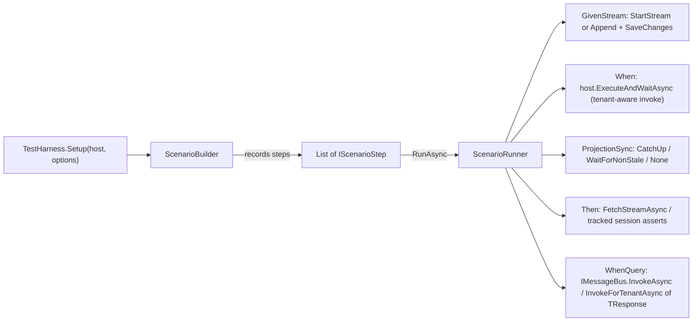
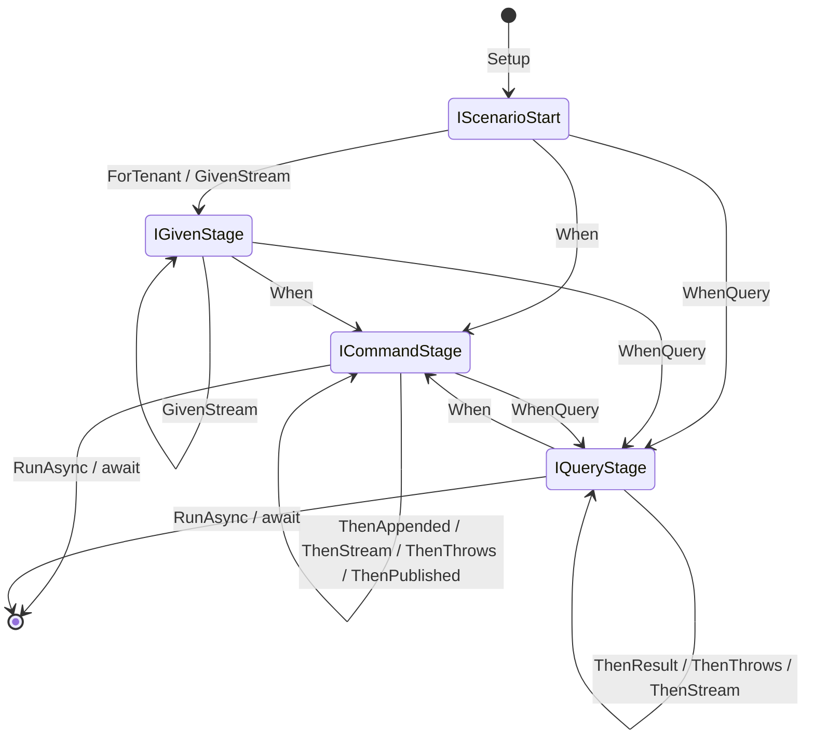

# 01: Harness design

A standalone, reusable, fluent Given/When/Then test harness for Marten and Wolverine. It plugs into any service's Alba host, sends commands and queries through Wolverine, and asserts on stream events and query results.

- **Status:** implemented (v1). This was the build plan, `initial-design.md`; the v1 version is at commit `01a7e35`.
- **Grounded in:** PDR-0001 to PDR-0009, ADR-0002 to ADR-0012 (see the [map](./README.md#where-each-record-lands)).
- **Build log:** the todo list that drove v1 is in [implementation-plan/00-overview.md](../implementation-plan/00-overview.md#v1-build-log).

The records are the contract. Where this document and a record disagree, the record wins and this document is fixed. Verification notes ("verified") refer to Marten 9.44, Wolverine 6.44 and Alba 8.5.3 ([ADR-0002](../architecture-decision-log/ADR-0002-pinned-critter-stack-versions.md)).

## Target API

```csharp
[Collection(nameof(NoDaemonCollection))]
public class WidgetScenarios(NoDaemonHostFixture fixture)
{
    [Fact]
    public async Task Renaming_widget_appends_WidgetRenamed()
    {
        var id1 = Guid.NewGuid();

        await TestHarness
            .Setup(fixture.Host, o => o.ProjectionTimeout = TimeSpan.FromSeconds(30))
            .GivenStream<Widget>(id1, id => [new WidgetCreated(id, "Sprocket")])
            .When(() => new RenameWidget(id1, "Gear"))
            .ThenAppended<WidgetRenamed>(id1, e => e.Name == "Gear")
            .ThenAppendedCount(id1, 1)
            .WhenQuery<WidgetSummary>(() => new GetWidgetById(id1))
            .ThenResult(r => r.Name == "Gear")
            .RunAsync(); // scenario is also awaitable directly
    }

    [Fact]
    public async Task Query_only_scenario()
    {
        var id1 = Guid.NewGuid();

        await TestHarness
            .Setup(fixture.Host)
            .GivenStream<Widget>(id1, id => [new WidgetCreated(id, "Sprocket")])
            .WhenQuery<WidgetSummary>(() => new GetWidgetById(id1))
            .ThenResult(r => r.Id == id1);
    }
}
```

## Design

> Records: [PDR-0001](../product-decision-log/PDR-0001-fluent-scenarios-on-the-services-own-host.md), [PDR-0002](../product-decision-log/PDR-0002-appended-vs-whole-stream-assertions.md), [PDR-0003](../product-decision-log/PDR-0003-projections-current-before-every-action.md), [PDR-0004](../product-decision-log/PDR-0004-handler-exceptions-are-assertable.md), [PDR-0005](../product-decision-log/PDR-0005-failures-show-the-actual-data.md), [PDR-0007](../product-decision-log/PDR-0007-one-tenant-per-scenario.md), [PDR-0008](../product-decision-log/PDR-0008-v1-non-goals.md); [ADR-0004](../architecture-decision-log/ADR-0004-self-contained-harness-project.md) to [ADR-0010](../architecture-decision-log/ADR-0010-payloads-use-the-stores-serializer.md).



- **Deferred execution:** each fluent call adds a step to a list. `RunAsync()` (or awaiting the builder through `GetAwaiter`) runs the steps in order. This lets the whole scenario read as one synchronous chain.
- **Dependency rule:** the harness depends only on the Alba, Marten and Wolverine abstractions. It has no knowledge of any service's aggregates, projections, schemas, fixtures or transports, so any service can add the `CritterStack.TestHarness` package and use it unchanged ([ADR-0013](../architecture-decision-log/ADR-0013-ship-the-harness-as-a-nuget-package.md)). Everything that varies between services is set through `HarnessOptions`.
- **Setup:** `TestHarness.Setup(IHost host, Action<HarnessOptions>? configure)`. `IAlbaHost` is an `IHost`, so any service's existing Alba fixture works. The harness never builds or owns a host; the caller's fixture owns the host, containers and lifetime. Options:
  - `ProjectionSync`, one of:
    - `CatchUp` (default): forces every async projection to catch up, whether or not the host runs a daemon. `ForceAllMartenDaemonActivityToCatchUpAsync` alone can't do this, because it needs the daemon's `IProjectionCoordinator` and throws `InvalidOperationException` on a host without one (verified). So the harness picks a path at run time:
      - host has an `IProjectionCoordinator` (it runs `AddAsyncDaemon`): `host.ForceAllMartenDaemonActivityToCatchUpAsync(ct)`. It returns `IReadOnlyList<Exception>`; a non-empty list is a projection failure and fails the scenario as an infrastructure failure. That list misses an apply error the daemon hit on its own run, outside the forced catch-up, so a per-scenario shard watcher on the store's `ShardStateTracker` reports those pauses too ([ADR-0016](../architecture-decision-log/ADR-0016-shard-watcher-catches-missed-apply-errors.md)).
      - host has none: `store.BuildProjectionDaemonAsync()`, then `daemon.CatchUpAsync(ProjectionTimeout, ct)`, then dispose the daemon.
      - Both paths were verified against Marten 9.44. The second path must never run on a host that has a daemon: it fails with `ProgressionProgressOutOfOrderException` because two daemons fight over the same projection progress.
    - `WaitForNonStale`: calls `host.WaitForNonStaleProjectionDataAsync(ProjectionTimeout)`, for hosts that already run the daemon. On a host with no daemon it always times out (`TimeoutException`), so it is only valid with a daemon (verified).
    - `None`: for services with only inline projections.
  - `ProjectionTimeout`
  - `TrackingTimeout`
  - `IncludeExternalMessages` (Wolverine tracking)
- **v1 scope: main store, Guid stream ids.** The harness always uses the host's main `IDocumentStore` and supports only `StreamIdentity.AsGuid`. Stream methods take a `Guid` id and come in plain and `<TAggregate>` forms. Not in v1:
  - **String stream ids** (`StreamIdentity.AsString`): would add `string` overloads of every stream method, plus a test host configured for string ids.
  - **Ancillary stores** (`IDocumentStore` subtypes): would need a generic `UseStore<TStore>()` option so projection sync can call the `<TStore>` overloads of the host sync methods.
- **Multi-tenancy:** one tenant per scenario. `Setup` returns `IScenarioStart`, which adds `ForTenant(tenantId)` on top of `IGivenStage`. `ForTenant` returns a plain `IGivenStage`, so it can only be called once, straight after `Setup` and before any Given. If it isn't called, the scenario uses Marten's default tenant. When a tenant is set, every step uses it:
  - Givens and all Then reads open sessions with `store.LightweightSession(tenantId)`;
  - `When` runs `host.TrackActivity().Timeout(TrackingTimeout)[.IncludeExternalTransports()].ExecuteAndWaitAsync(c => c.InvokeForTenantAsync(tenantId, command))`;
  - `WhenQuery` runs `bus.InvokeForTenantAsync<TResponse>(tenantId, query)`.
  - Without a tenant, `When` uses `c.InvokeAsync(command)` and `WhenQuery` uses `bus.InvokeAsync<TResponse>(query)`. Both paths share one code path that only differs in the invoke call.
  - Verified: the handler's `IDocumentSession.TenantId` is the scenario's tenant under `InvokeForTenantAsync`, and `*DEFAULT*` (Marten's default tenant id) without one. A stream written for tenant `a` is invisible to tenant `b` (`FetchStreamAsync` returns no events, `FetchStreamStateAsync` returns `null`).
  - `ExecuteAndWaitAsync` has both `Func<IMessageContext, Task>` and `Func<IMessageContext, ValueTask>` overloads, so an `async` lambda is ambiguous (CS0121). Cast it to `Func<IMessageContext, Task>`.
- **Givens:**
  - `GivenStream(Guid id, Func<Guid, object[]> events)` and `GivenStream<TAggregate>(...)` write events to a stream. The scenario remembers which stream ids its Givens have already started:
    - the first `GivenStream` for an id calls `session.Events.StartStream` (`StartStream<TAggregate>` for the generic form);
    - later `GivenStream` calls for the same id call `session.Events.Append`, so a stream's history can be built up over several Givens.
    - On an append, the `<TAggregate>` type argument is ignored, because the stream's aggregate type was set when it started. A mismatched `<TAggregate>` on a later Given is not an error.
    - The first Given for an id always starts a new stream. If that id already exists in the database (for example, an id reused across tests), Marten's collision error fails the scenario at once as an infrastructure failure. Tests should use a fresh id each time.
  - Each Given is a separate `SaveChangesAsync`.
- **Projection sync:** the harness runs the configured `ProjectionSync` step right *before* each `When` and each `WhenQuery`, so that both a query handler and a command handler that happens to read a projection see up-to-date data. It makes no assumption about which projections exist or how the host runs them.
  - The runner keeps a "dirty" flag that is set by every Given and every `When`. A sync before a `When` or `WhenQuery` only runs if the flag is set, and clears it. So `WhenQuery` → `WhenQuery` syncs once, and a scenario that starts with `WhenQuery` and has no Givens doesn't sync at all.
  - There is no sync after the last step or before a `Then`. Stream assertions read events directly, and `ThenPublished` reads the tracked session, so neither needs projections. To assert on a read model after a `When`, follow it with a `WhenQuery`, which syncs first.
  - A sync that exceeds `ProjectionTimeout` is an infrastructure failure (see **Captured exceptions**).
- **When:**
  - `When(Func<object> command)` runs projection sync if needed, then invokes the command under Wolverine tracking with `TrackActivity()...ExecuteAndWaitAsync(...)` (tenant-aware, see **Multi-tenancy**). It keeps the `ITrackedSession` for `ThenPublished`.
  - If the command throws, the harness captures the exception for `ThenThrows<T>` instead of failing straight away.
- **Captured exceptions (When and WhenQuery alike):**
  - Both `When` and `WhenQuery` capture an exception thrown by the *handler* instead of failing straight away.
  - Only handler exceptions can be claimed. Harness and infrastructure failures are test setup bugs, not behaviour under test, so they fail the scenario at once with a `HarnessAssertionException` that names the step:
    - `WhenQuery<TResponse>` where the handler's response isn't a `TResponse`;
    - a Wolverine tracking timeout on `When` (`TrackingTimeout` exceeded);
    - no handler registered for the command or query;
    - projection sync failing or timing out (`ProjectionTimeout` exceeded);
    - a Given whose stream id already exists in the database.
  - **How each case actually surfaces** (verified against Marten 9.44 / Wolverine 6.44 on a real host, with and without a daemon). One internal classifier holds this table:

    | Case | What Wolverine/Marten does | Harness treats it as |
    |---|---|---|
    | Handler throws, `When` | the handler's own exception, rethrown as-is (e.g. `WidgetException`), not wrapped | captured, claimable |
    | Cascaded handler throws, `When` | `AggregateException` whose `InnerExceptions` are the handler exceptions | captured, claimable (unwrapped, see `ThenThrows`) |
    | Handler throws, `WhenQuery` | the handler's own exception, as-is | captured, claimable |
    | Tracking timeout | `System.TimeoutException` ("This TrackedSession timed out before all activity completed"), with an inner `TimeoutException` ("The operation has timed out."); thrown even with `DoNotAssertOnTimeout()` | infrastructure, fails at once |
    | Handler throws its own `TimeoutException`, `When` | **the same wrapper** as a tracking timeout ("This TrackedSession timed out…"), with the handler's `TimeoutException` as the inner exception, thrown immediately (found while building the tests) | handler exception: unwrapped to the inner exception, claimable |
    | No handler | `Wolverine.Runtime.Routing.IndeterminateRoutesException`, from both tracked and untracked invokes | infrastructure, fails at once |
    | Wrong `TResponse` | **no exception.** Wolverine returns `default(TResponse)` (`null`, or `0` for value types) | the harness checks the type itself (see below); a mismatch is infrastructure, fails at once |
    | `CatchUp` path error | `ForceAll…` returns a non-empty `IReadOnlyList<Exception>`; `BuildProjectionDaemonAsync` path throws | infrastructure, fails at once |
    | `WaitForNonStale` timeout | `System.TimeoutException` | infrastructure, fails at once |
    | Given stream collision | `Marten.Exceptions.ExistingStreamIdCollisionException` from `SaveChangesAsync` | infrastructure, fails at once |

  - **Classification rule:** because a handler exception can be *any* type (including `TimeoutException`), the classifier goes by *where* the exception came from, not only its type: exceptions from projection sync and from Givens are always infrastructure; from a `When` or `WhenQuery`, `IndeterminateRoutesException` is infrastructure, and so is the tracked-session timeout wrapper **only if** the `When` ran for at least 90% of `TrackingTimeout`. Wolverine uses the identical wrapper for a handler's own `TimeoutException`, so elapsed time is the only reliable signal; a wrapper that arrives early is unwrapped and captured as the handler's exception. Everything else is a handler exception.
  - **Wrong `TResponse` is detected by the harness, not by Wolverine.** `WhenQuery<TResponse>` invokes with `InvokeAsync<object>` / `InvokeForTenantAsync<object>`, which returns the handler's real response object (verified), then checks it:
    - a non-null result that isn't a `TResponse` fails at once: "`WhenQuery<TResponse>` expected `<TResponse>`, handler returned `<actual type>`";
    - a `null` result is passed through as `default(TResponse)`. A query handler may legitimately return `null`, and Wolverine also gives `null` for a handler with no return value; the two can't be told apart, so `ThenResult`'s predicate receives `null` and decides.
  - `ThenThrows<T>` checks the most recent captured exception. Its type has to match `T` (including subclasses), or, if it is an `AggregateException` from a cascade, one of its `InnerExceptions` has to; the optional predicate runs against that matching exception.
  - An unclaimed exception fails the scenario at the first point where it could hide the real cause: the first `Then` after the throwing step that isn't a `ThenThrows`, or the next `When`/`WhenQuery`, or the end of the scenario, whichever comes first. That step doesn't run its own check. It reports "`<step>` threw `<type>`" with the original exception attached as `InnerException`. So when you expect an exception, put `ThenThrows` first:
    ```csharp
    .When(() => new FailWidget(id))
    .ThenThrows<WidgetException>()        // claims it
    .ThenNotAppended<WidgetRenamed>(id)   // now runs normally
    ```
  - Once claimed, the exception no longer blocks later `Then`s. `ThenResult` after a claimed query exception still fails, with "query threw `<type>`, no result" rather than a null-reference error.
  - `ThenThrows` after a `When` or `WhenQuery` that didn't throw fails with "expected `<type>`, nothing thrown".
  - Every `HarnessAssertionException` caused by an exception (unclaimed handler exceptions and the infrastructure failures above) keeps the original as `InnerException`, so its message and stack trace show up in test output. This is deliberate: the harness only runs in tests, so being able to debug a failure matters more than hiding exception text. The harness's own message still leads with the step name and exception type so the cause is obvious at a glance.
- **Thens:**
  - **Appended-event assertions** (command stage only). These check only the events the most recent `When` appended:
    - `ThenAppended<T>(id, predicate?)`
    - `ThenNotAppended<T>(id, predicate?)`
    - `ThenAppendedCount(id, n)`
  - **Whole-stream assertions** (after any `When` or `WhenQuery`). These read the full stream with `FetchStreamAsync`, including events from Givens and from earlier `When`s:
    - `ThenStreamHasEvent<T>(id, predicate?)`
    - `ThenStreamHasNoEvent<T>(id, predicate?)`
    - `ThenStreamEventCount(id, n)`
  - `ThenThrows<TException>(predicate?)`, valid after a `When` or a `WhenQuery`.
  - `ThenPublished<TMessage>(predicate?)`, which reads from the tracked session and is valid only after a `When`.
- **How "appended" is measured:** because execution is deferred, the runner knows every stream id that an appended-event assertion uses before the `When` runs. Right before invoking the command, the `When` step reads `FetchStreamStateAsync` for each of those ids and stores the version (0 when it returns `null`, which it does for a stream that doesn't exist yet, verified). The appended-event assertions then call `FetchStreamAsync(id, fromVersion: snapshot + 1)`, which returns only the newer events (verified: after a rename, `fromVersion: 2` returns just `2:widget_renamed`). Streams that no appended-event assertion mentions are never snapshotted.
- **`ThenPublished` reads `ITrackedSession.Sent`.** Verified for a handler that returns a cascading message: `Sent` holds only the cascaded message, while `Executed` holds both the command and the cascaded message. So `ThenPublished<T>` matches against `tracked.Sent.MessagesOf<T>()`, and its failure message lists `tracked.Sent.AllMessages()`.
- **Step ordering:** the stage interfaces below enforce the order at compile time.
  - `When` is optional. A scenario can go straight from the Givens to `WhenQuery`, as in `Setup → GivenStream... → WhenQuery → ThenResult`, or even from `Setup` to `WhenQuery` with no Givens.
  - Givens are allowed only before the first `When` or `WhenQuery`.
  - Whole-stream assertions need a `When` or a `WhenQuery` before them. Appended-event assertions need a `When`, because a query appends nothing.
  - `ThenThrows` exists after a `When`, `WhenQuery` or `WhenHttp`. `ThenPublished` exists after a `When` or `WhenHttp`, because a query invoke has no tracked session.
  - Projection sync runs before each `When`, `WhenQuery` and `WhenHttp` when anything has been written since the last sync (see **Projection sync**).
  - `ThenThrows`, `ThenResult`, `ThenPublished`, `ThenStatusCode`, `ThenResponse` and the appended-event assertions refer to the most recent `When`, `WhenQuery` or `WhenHttp` before them. Whole-stream assertions always see the whole stream as it is when they run.
- **Queries:** `WhenQuery<TResponse>(Func<object> query)` runs projection sync if needed, then runs `IMessageBus.InvokeAsync<object>` (or `InvokeForTenantAsync<object>`), checks the result is a `TResponse` (see **Captured exceptions**) and stores it typed. Queries are not tracked, so anything a query handler cascades is not waited for. `ThenResult(Func<TResponse, bool>)` asserts on the response with no runtime cast. Queries run through Wolverine; HTTP requests are `WhenHttp` (below).
- **HTTP requests** (added 2026-11-16, [PDR-0011](../product-decision-log/PDR-0011-scenarios-can-test-http-endpoints.md), [ADR-0014](../architecture-decision-log/ADR-0014-whenhttp-through-alba-under-tracking.md)): `WhenHttp(Action<Alba.Scenario> request)` returns `IHttpStage`. It syncs projections if needed, snapshots planned streams, then runs `IAlbaHost.Scenario(...)` inside `TrackActivity(TrackingTimeout).ExecuteAndWaitAsync`, with Alba's status check turned off. It keeps the `IScenarioResult` and the `ITrackedSession`. Without a `ThenStatusCode` before the next action, a non-2xx fails at once with the body. `IHttpStage` adds `ThenStatusCode`, `ThenResponse<TBody>` (Alba's JSON strategy) and the command-stage `ThenAppended*`/`ThenPublished`. An endpoint exception is captured like a handler's; a late tracked-session timeout is infrastructure. Under `ForTenant`, `HarnessOptions.HttpTenant` adds the tenant to the request, and is required.
- **Failures:** the harness throws `HarnessAssertionException`. The message names the failing step, then shows what was actually there so a failed predicate is easy to diagnose:
  - stream assertions list each relevant event (the whole stream, or only the appended events for `ThenAppended*`) with its version, type name and JSON payload;
  - `ThenResult` shows the query response as JSON;
  - `ThenPublished` lists the tracked messages with their type names and JSON payloads.
  - Payloads are serialized with the store's own Marten serializer (`IDocumentStore.Options.Serializer()`), so the JSON matches what is stored, including any custom converters. Payloads are included in full, because the harness only runs in tests.
- **No data wipe:** the harness never calls `ResetAllMartenDataAsync` or `CleanAllMartenDataAsync`, because those truncate tables. Isolating tests is the caller's job, for example with a fresh id per test.

## Fluent stage interfaces

> Records: [ADR-0005](../architecture-decision-log/ADR-0005-deferred-steps-and-staged-interfaces.md).

Each method returns the interface for the next stage, so IntelliSense offers only valid steps and a misordered scenario fails to compile. The interfaces only limit what can be called next; behind them:

- One internal, non-generic `ScenarioBuilder` owns the recorded step list and implements `IScenarioStart`, `IGivenStage` and `ICommandStage`.
- Each `WhenQuery<TResponse>` call returns a new, lightweight internal `QueryStage<TResponse>` that implements `IQueryStage<TResponse>` and forwards every call to the same `ScenarioBuilder`. A builder can't be generic, because `IGivenStage` and `ICommandStage` exist before any `TResponse` is known and each `WhenQuery` in a chain can use a different `TResponse`.

```csharp
namespace CritterStack.TestHarness;

// TestHarness.Setup(host, o => ...) returns IScenarioStart.

public interface IScenario
{
    Task RunAsync(CancellationToken cancellationToken = default);
    TaskAwaiter GetAwaiter();
}

// Only available straight after Setup, so the tenant is set once for the whole scenario.
public interface IScenarioStart : IGivenStage
{
    IGivenStage ForTenant(string tenantId);
}

public interface IGivenStage
{
    IGivenStage GivenStream(Guid id, Func<Guid, object[]> events);
    IGivenStage GivenStream<TAggregate>(Guid id, Func<Guid, object[]> events) where TAggregate : class;

    ICommandStage When(Func<object> command);
    IQueryStage<TResponse> WhenQuery<TResponse>(Func<object> query);
}

// Steps valid after any When or WhenQuery. Stream assertions here are whole-stream.
public interface IThenStage<out TSelf> : IScenario
    where TSelf : IThenStage<TSelf>
{
    TSelf ThenStreamHasEvent<TEvent>(Guid id, Func<TEvent, bool>? predicate = null);
    TSelf ThenStreamHasNoEvent<TEvent>(Guid id, Func<TEvent, bool>? predicate = null);
    TSelf ThenStreamEventCount(Guid id, int expected);

    TSelf ThenThrows<TException>(Func<TException, bool>? predicate = null) where TException : Exception;

    ICommandStage When(Func<object> command);
    IQueryStage<TResponse> WhenQuery<TResponse>(Func<object> query);
}

// After When(command): adds the command-only assertions (appended events and tracked session).
public interface ICommandStage : IThenStage<ICommandStage>
{
    ICommandStage ThenAppended<TEvent>(Guid id, Func<TEvent, bool>? predicate = null);
    ICommandStage ThenNotAppended<TEvent>(Guid id, Func<TEvent, bool>? predicate = null);
    ICommandStage ThenAppendedCount(Guid id, int expected);

    ICommandStage ThenPublished<TMessage>(Func<TMessage, bool>? predicate = null);
}

// After WhenQuery<TResponse>(query): adds a typed result assertion.
public interface IQueryStage<TResponse> : IThenStage<IQueryStage<TResponse>>
{
    IQueryStage<TResponse> ThenResult(Func<TResponse, bool> predicate);
}
```



- Only `ICommandStage` and `IQueryStage` can be run or awaited. A scenario with only Givens has nothing to check, so it won't compile as a runnable scenario.
- Because every `QueryStage<TResponse>` forwards to the one `ScenarioBuilder`, switching between commands and queries keeps the full history in a single step list.

## Files

> Records: [ADR-0002](../architecture-decision-log/ADR-0002-pinned-critter-stack-versions.md), [ADR-0004](../architecture-decision-log/ADR-0004-self-contained-harness-project.md), [ADR-0011](../architecture-decision-log/ADR-0011-build-quality-versioning-and-ci.md).

This is a standalone repo. The harness library lives in `src/CritterStack.TestHarness/` (root namespace `CritterStack.TestHarness`).

Repo scaffolding:

- `src/CritterStack.TestHarness.slnx`: solution file containing the harness and its test project.
- `global.json` (repo root): pins the .NET 10 SDK (`10.0.302`, `rollForward: latestFeature`) and sets `"test": { "runner": "Microsoft.Testing.Platform" }`. xunit v3 runs on Microsoft.Testing.Platform, and the .NET 10 SDK refuses to run it through the old VSTest `dotnet test` path without this opt-in (verified).
- `nuget.config` (repo root): copied from awen. It clears the default sources, then adds nuget.org and the festina-lente-io GitHub Packages feed, and maps `FestinaLente.*` to the GitHub feed and everything else to nuget.org:

  ```xml
  <packageSources>
    <clear />
    <add key="nuget.org" value="https://api.nuget.org/v3/index.json" protocolVersion="3" />
    <add key="github" value="https://nuget.pkg.github.com/festina-lente-io/index.json" />
  </packageSources>
  <packageSourceMapping>
    <packageSource key="nuget.org"><package pattern="*" /></packageSource>
    <packageSource key="github"><package pattern="FestinaLente.*" /></packageSource>
  </packageSourceMapping>
  ```

  GitHub Packages needs authentication even for reads. Locally, restore needs a GitHub token with `read:packages` stored for the `github` source (`dotnet nuget update source github --username <user> --password <token> --store-password-in-clear-text`); CI uses `GITHUB_TOKEN`.
- `src/Directory.Packages.props`: central package versions, pinned to the latest stable releases (as of 2026-10-01):

  | Package | Version |
  |---|---|
  | Marten | 9.44.0 |
  | WolverineFx | 6.44.0 |
  | WolverineFx.Marten | 6.44.0 |
  | Alba | 8.5.3 |
  | Testcontainers.PostgreSql | 4.15.0 |
  | WolverineFx.RuntimeCompilation | 6.44.0 |
  | xunit.v3 (needed for assembly fixtures) | 4.0.1 |
  | xunit.runner.visualstudio | 4.0.0 |
  | Microsoft.NET.Test.Sdk | 18.10.1 |
  | GitVersion.MsBuild | 6.8.2 |
  | FestinaLente.CodeStandards | 1.1.10 |

  All of them ship `net10.0` builds. `WolverineFx.Marten` 6.44.0 requires Marten ≥ 9.41.0, which 9.44.0 satisfies. `WolverineFx.RuntimeCompilation` is needed because WolverineFx 6.44 no longer ships the runtime (Roslyn) compiler: a host in the default `TypeLoadMode.Dynamic` fails to start without it (verified). The test project references it; the harness library doesn't need it.
- `src/Directory.Build.props`: `TargetFramework` `net10.0`, `Nullable` enabled, `ImplicitUsings` enabled, `TreatWarningsAsErrors` on, `IncludeSourceRevisionInInformationalVersion` false, `GitVersion.MsBuild` and `FestinaLente.CodeStandards` (both `PrivateAssets="all"`) on every project, `stylecop.json` added as an `AdditionalFiles` item, and xunit v3 and the test SDK added to every `*.Tests` project. `GenerateDocumentationFile` is on for non-test projects, so with warnings as errors a missing XML doc comment on any public member (CS1591) fails the build.
- `src/Directory.Build.targets`: copied verbatim from awen. It removes the `stylecop.json` that ships inside the CodeStandards package so only the repo's copy is used. This has to be a `.targets` file, because NuGet package props are imported after `Directory.Build.props`:

  ```xml
  <Project>
    <!-- Remove the NuGet package's stylecop.json, keeping only the repo-root copy.
         This must be in .targets (not .props) because NuGet package props are imported after Directory.Build.props. -->
    <Target Name="DeduplicateStylecopJson" BeforeTargets="CoreCompile">
      <ItemGroup>
        <AdditionalFiles Remove="%(Identity)" Condition="'%(Filename)%(Extension)' == 'stylecop.json' and '%(Identity)' != '$(MSBuildThisFileDirectory)stylecop.json'" />
      </ItemGroup>
    </Target>
  </Project>
  ```

  It keeps only the `stylecop.json` in its own folder (`$(MSBuildThisFileDirectory)`), so `Directory.Build.props`, `Directory.Build.targets` and `stylecop.json` must all stay together in `src/`. Moving one of them silently drops the repo's StyleCop settings.
- `src/stylecop.json`: copied from awen (company name, copyright header, documentation and ordering rules), so analyzer settings match across repos.
- `GitVersion.yml` (repo root): copied from `ryandanthony/awen` so versioning works the same way across repos:
  - `mode: ContinuousDelivery`, `tag-prefix: v`, strategies `Mainline` and `TaggedCommit`;
  - assembly version `MajorMinor`, file version `MajorMinorPatch`, informational version `{SemVer}+{ShortSha}`;
  - Conventional Commit bump messages: `type!:` is major, `feat:` is minor, `fix:` is patch, and `docs`/`style`/`chore`/`ci`/`build`/`test`/`refactor` don't bump;
  - branches: `main` (ContinuousDeployment, no label, patch increment), `feature/`/`feat/` (label `{BranchName}`), `NNN-` spec branches (label `alpha`) and `pull/`/`pr/` (label `pr`).
  - `GitVersion.MsBuild` stamps the version into every assembly at build time and writes `obj/gitversion.json`, so there is no hand-maintained version anywhere in the repo.
- `justfile` (repo root): `restore`, `build` (Release, over the slnx) and `test` (depends on `build`; runs `dotnet test --solution src/CritterStack.TestHarness.slnx --no-build --configuration Release --report-xunit-trx --results-directory TestResults`) recipes. Microsoft.Testing.Platform exits with code 8 when zero tests run, so `just test` fails until the first test exists.
- `.github/workflows/build.yml`: CI, modelled on awen's `build.yml`. Runs on pull requests to `main`, pushes to `main` and `workflow_dispatch`, on `ubuntu-latest` (which has Docker, so Testcontainers works without setup). Steps:
  1. `actions/checkout@v4` with `fetch-depth: 0` (GitVersion needs the full history and tags);
  2. `actions/setup-dotnet@v4` (SDK from `global.json`);
  3. `actions/cache@v4` for `~/.nuget/packages`, keyed on the csproj and props files;
  4. configure the `github` NuGet source with `GITHUB_TOKEN` (`dotnet nuget update source github --username github --password ${{ secrets.GITHUB_TOKEN }} --store-password-in-clear-text`), with the workflow granted `packages: read`;
  5. install `just` (`extractions/setup-just`);
  6. `just build`;
  7. extract the version from `src/CritterStack.TestHarness/obj/gitversion.json` (`SemVer` and `MajorMinorPatch`) into step outputs and the job summary;
  8. `just test`;
  9. upload the `*.trx` files as a workflow artifact (`actions/upload-artifact@v4`, `if: always()`), so failed runs keep their results.
  - Packing and publishing (added 2026-11-16, [ADR-0013](../architecture-decision-log/ADR-0013-ship-the-harness-as-a-nuget-package.md)): every run packs and uploads the `.nupkg`/`.snupkg`, runs `just package-check`, and a manual `workflow_dispatch` with `publish: true` on `main` publishes to nuget.org via trusted publishing, tags `v{MajorMinorPatch}` and creates a GitHub release.

Harness library:

- `src/CritterStack.TestHarness/CritterStack.TestHarness.csproj`: references Alba, Marten and WolverineFx with central versions, and is packable as `CritterStack.TestHarness` (MIT, README, XML docs, symbols). CodeStandards and GitVersion come from `Directory.Build.props` with `PrivateAssets="all"`, so the package depends on those three packages only ([ADR-0013](../architecture-decision-log/ADR-0013-ship-the-harness-as-a-nuget-package.md)).
Public API (namespace `CritterStack.TestHarness`):

- `TestHarness.cs`: static `Setup` entry point.
- `HarnessOptions.cs` and `ProjectionSync.cs` (the sync-mode enum).
- `HarnessAssertionException.cs`
- `Stages/`: `IScenario.cs`, `IScenarioStart.cs`, `IGivenStage.cs`, `IThenStage.cs`, `ICommandStage.cs` and `IQueryStage.cs`, one public interface per file.

Internals (namespace `CritterStack.TestHarness.Internal`, all `internal`):

- `ScenarioBuilder.cs`: implements `IScenarioStart`, `IGivenStage` and `ICommandStage`, records the steps and holds the scenario's tenant id. Exposes the last run's `ScenarioContext` to the test project (through `InternalsVisibleTo`) for the sync-count test.
- `QueryStage.cs`: `QueryStage<TResponse>`, created per `WhenQuery` call. It implements `IQueryStage<TResponse>` and forwards to the owning `ScenarioBuilder`.
- `ScenarioRunner.cs`: plans stream snapshots, runs the steps in order and enforces the unclaimed-exception rule.
- `ScenarioContext.cs`: host, store, tenant, tracked session, captured exception, last query result, stream-version snapshots, the started-stream set, the projection-sync dirty flag and sync count.
- `IScenarioStep.cs` and `StepKind.cs`: the step contract.
- `ProjectionSyncRunner.cs`: the dirty-flag check and the three sync modes, including the two `CatchUp` paths.
- `ExceptionClassifier.cs`: handler vs infrastructure classification, `ThenThrows` matching and `AggregateException` unwrapping.
- `PayloadFormatter.cs` and `Failure.cs`: failure-message formatting with the store's serializer.
- `Steps/`: `GivenStreamStep`, `WhenCommandStep`, `WhenQueryStep`, `StreamAssertionStep` (whole-stream and appended assertions, selected by `StreamScope` and `StreamCheck`), `ThrowsAssertionStep`, `PublishedAssertionStep`, `ResultAssertionStep`, plus the helpers `IActionStep`, `ActionMessage` and `Predicates`.

## Tests

> Records: [ADR-0003](../architecture-decision-log/ADR-0003-real-postgres-test-hosts.md), [ADR-0012](../architecture-decision-log/ADR-0012-docs-and-portability-enforced-by-tests.md). The list below is the v1 baseline; the suite has grown since (135 tests at 2026-11-16, see the [build log](../implementation-plan/00-overview.md#v1-build-log)).

The harness gets its own test project, `src/CritterStack.TestHarness.Tests/`, which travels with the harness. It has its own tiny test domain and host:

- `TestDomain/`: a minimal domain that exercises every harness feature without depending on any service:
  - an aggregate, `Widget`;
  - events `WidgetCreated`, `WidgetRenamed` and `WidgetPublished`;
  - commands `RenameWidget`, `PublishWidget` (which cascades a `WidgetPublishedNotice` message), `FailWidget` (whose handler throws `WidgetException`), `StallWidget` (whose handler waits longer than a short test `TrackingTimeout`, to prove timeouts can't be claimed) and `ArchiveWidget` (whose handler loads the async `WidgetSummary` read model and throws if it is missing, to prove the sync before a `When`);
  - a query `GetWidgetById` plus its handler, which returns the async `WidgetSummary` read model and throws `WidgetNotFoundException` for an unknown id;
  - two read models: `WidgetDetails` (inline projection, always current after `SaveChanges`) and `WidgetSummary` (async projection, only current after projection sync). The `CatchUp`, `WaitForNonStale` and `None` tests all use `WidgetSummary`.
- `Infrastructure/PostgresContainerFixture.cs`: an xUnit v3 assembly fixture (`[assembly: AssemblyFixture(typeof(PostgresContainerFixture))]`) that starts one Postgres Testcontainer for the whole test assembly and exposes its connection string.
- `Infrastructure/HarnessHostFixture.cs`: an abstract base that takes the container fixture and builds `AlbaHost.For(WebApplication.CreateBuilder())`. On that host it runs `AddMarten(...).IntegrateWithWolverine()` with the test projections, plus Wolverine with `DisableAllExternalWolverineTransports()`. The event store uses conjoined tenancy (`Events.TenancyStyle = TenancyStyle.Conjoined`) and Wolverine's Marten integration routes invokes by tenant id, so `ForTenant` can be tested; scenarios without `ForTenant` run on the default tenant. Each subclass sets its own schema (`DatabaseSchemaName`, `Events.DatabaseSchemaName` and Wolverine's message storage schema through `IntegrateWithWolverine(x => x.MessageStorageSchemaName = ...)`), so the two hosts never see each other's events, read models or envelopes:
  - `NoDaemonHostFixture`: schema `harness_nodaemon`, no daemon registered, so `CatchUp` is proven against a host that has none and `None` reliably leaves the async read model stale.
  - `DaemonHostFixture`: schema `harness_daemon`, `AddAsyncDaemon(DaemonMode.Solo)`, for `WaitForNonStale`.
- `Infrastructure/NoDaemonCollection.cs` and `Infrastructure/DaemonCollection.cs`: two xUnit collection definitions, `NoDaemonCollection` (uses `NoDaemonHostFixture`) and `DaemonCollection` (uses `DaemonHostFixture`). The collections run in parallel with each other; tests inside one collection run one after another.
- `DocSamples/`: the tutorial's fixture and samples (`WidgetServiceFixture`, `FirstScenarioSamples`), and the how-to samples (`HowToSamples` on the no-daemon host, `DaemonHowToSamples` on the daemon host). Each test names the page and section it backs (see **Documentation**).
- `TestHarnessTests.cs`, `ProjectionSyncTests.cs`, `DaemonProjectionSyncTests.cs` (the daemon-host cases), `StepOrderingTests.cs` and `AssertionMessageTests.cs`, with `Scenarios.cs` as a small helper, which together cover:
  - a Given creates the stream, in both its plain and `<TAggregate>` forms;
  - two `GivenStream` calls with the same id build one stream (start, then append), and `ThenStreamEventCount` sees all of their events;
  - `ForTenant("a")` Givens, `When` and `ThenAppended` all run as tenant `a`, and the command handler's session sees tenant `a`;
  - a stream given under tenant `a` is not visible to a scenario that uses `ForTenant("b")` (`ThenStreamEventCount(id, 0)`);
  - `WhenQuery` under `ForTenant` returns that tenant's read model;
  - steps run only on `RunAsync` or `await`;
  - a failed `ThenStreamHasEvent` throws `HarnessAssertionException` whose message includes each actual event's version, type name and JSON payload;
  - a failed `ThenResult` includes the response as JSON in its message;
  - `ThenAppended<WidgetCreated>` fails after a `When` when `WidgetCreated` came only from the Given, while `ThenStreamHasEvent<WidgetCreated>` passes;
  - after two `When`s, `ThenAppended` and `ThenAppendedCount` see only the second command's events;
  - `ThenAppended` works on a stream that the `When` itself creates (snapshot version 0);
  - `ThenThrows` captures a handler exception;
  - a tracking timeout fails the scenario at once as a `HarnessAssertionException` naming the `When` step, and `ThenThrows<TimeoutException>()` cannot claim it;
  - a `When` with no registered handler fails at once and cannot be claimed;
  - `ThenPublished` sees the cascaded message;
  - in `CatchUp` mode, `WhenQuery`/`ThenResult` reads the async read model;
  - `When` → `WhenQuery` sees the read model updated by the command's events (sync before the query);
  - a `When` whose handler reads the async read model sees data from the Givens (sync before the command);
  - `WhenQuery` → `WhenQuery` with nothing written in between syncs only once (verified by counting sync calls through an internal hook);
  - `ProjectionSync.None` leaves the async read model stale;
  - `WaitForNonStale` works against a host that runs a daemon;
  - a Given followed by `WhenQuery` and `ThenResult`, with no command, works;
  - a scenario that chains `When`, then `WhenQuery`, then `When`, then `WhenQuery` keeps the full step history, and each `Then` checks the right result;
  - `WhenQuery` for an unknown widget, then `ThenThrows<WidgetNotFoundException>()`, passes;
  - a `When` or `WhenQuery` that throws with no `ThenThrows` after it fails the scenario as an unexpected exception;
  - a `When` that throws, followed by `ThenAppended` and then `ThenThrows`, fails at `ThenAppended` with "`When` threw `<type>`" (not "no event appended"), and the handler exception is the `InnerException`;
  - `ThenThrows` followed by `ThenNotAppended` passes when the handler threw and appended nothing;
  - `ThenStreamHasNoEvent<WidgetRenamed>(id, e => e.Name == "Gear")` passes when the stream only has a rename to another name, and fails when it has a rename to `"Gear"`; the same for `ThenNotAppended`;
  - `ThenResult` after a query that threw fails with a clear message;
  - `ThenThrows` when nothing was thrown fails;
  - `WhenQuery<string>` against a handler that returns `WidgetSummary` fails at once with a `HarnessAssertionException` naming the step, the expected type and the actual type (Wolverine itself throws nothing);
  - a query whose handler returns `null` passes `null` to `ThenResult`'s predicate rather than failing;
  - a cascaded handler that throws surfaces as an `AggregateException` and `ThenThrows<WidgetException>()` still claims it;
  - a `When` command whose handler throws a `TimeoutException` of its own is claimable, while the tracked session's timeout is not;
  - `CatchUp` takes the `ForceAll…` path on the daemon host and the `BuildProjectionDaemonAsync` path on the no-daemon host, and both leave `WidgetSummary` current;
  - a Given that reuses an existing stream id fails at once with `ExistingStreamIdCollisionException` as `InnerException`;
  - an unclaimed handler exception's `HarnessAssertionException` has the original handler exception as `InnerException`.
- Package needs: Alba, Marten, WolverineFx, WolverineFx.Marten, WolverineFx.RuntimeCompilation and Testcontainers.PostgreSql, all pinned in `src/Directory.Packages.props`. xunit v3 comes from `src/Directory.Build.props` for `*.Tests`.
- Both host fixtures register handlers with `opts.Discovery.IncludeType(...)` for each `TestDomain` handler class. Verified: `IncludeAssembly(typeof(X).Assembly)` did not find handlers in the probe's entry assembly, and every invoke failed with `IndeterminateRoutesException`.

Every test gets a `business_value` trait that states what the test protects.

## Risks and verification findings

- **Verified portability (2026-10-01, superseded by the package check):** copying the project into a service that does not use this repo's build props was tried for real, and it failed twice before working: (1) the csproj had no `TargetFramework` (it came from `Directory.Build.props`), so it didn't build outside this repo; the csproj now sets `TargetFramework`, `Nullable` and `ImplicitUsings` itself; (2) the public `ScenarioAssertionException` clashed with `Alba.ScenarioAssertionException` (CS0104) in any test file that imports both namespaces, which every Alba-based consumer does; it is now `HarnessAssertionException`. `scripts/check-portability.sh` (`just portability`, run in CI) repeats the copy into a throwaway directory with its own package versions and nuget.org only, and runs a separate sample service (`samples/ConsumerService`, an Order domain) against it. It fails with the old csproj (checked).
- **Verified API reference completeness:** `ApiReferenceCoverageTests` fails the build if any public type, member or enum value of the harness is missing from `docs/reference/api.md` or `harness-options.md` (checked by adding an undocumented property and watching it fail). It checks presence, not that the description is right.
- **Verified (2026-10-01):** every Marten 9.44, Wolverine 6.44 and Alba 8.5.3 API this design names was checked three ways: Context7 docs, reflection over the pinned assemblies, and a runtime probe on a `net10.0` Alba host against Postgres 17 (Testcontainers), run once without and once with `AddAsyncDaemon(Solo)`. Findings are written into the sections above. The probe lives outside the repo; the `tests` todo turns each finding into a real test so a package upgrade that changes the behaviour fails CI.
- A future Wolverine or Marten release could change any of the behaviours in the classifier table (for example, start wrapping top-level handler exceptions, or start throwing for a wrong `TResponse`). The classifier tests are the guard.
- The harness tests' own host disables external transports, so tracking stays fast and predictable there. Consuming services whose hosts run real transports (for example Service Bus or Kafka emulators) may need `IncludeExternalMessages` or a longer `TrackingTimeout` for cascaded messages.
- `FestinaLente.CodeStandards` brings in analyzers (StyleCop and others) that, with warnings as errors, may flag code the design takes for granted, such as one public interface per file, file headers and member ordering. Fix the code to comply, and only suppress a rule in `.editorconfig` with a one-line reason. Observed at scaffold: every file needs the `stylecop.json` copyright header (`// <copyright file="X.cs" company="Ryan Anthony">`), and documented properties need a `<value>` tag (SA1609) as well as `<summary>`.
- Restore fails without a GitHub token for the `github` source, both locally and in CI.

## Documentation

> Records: [PDR-0009](../product-decision-log/PDR-0009-diataxis-docs-with-runnable-samples.md), [ADR-0012](../architecture-decision-log/ADR-0012-docs-and-portability-enforced-by-tests.md).

User docs follow [Diátaxis](https://diataxis.fr/). It separates four kinds of documentation by what the reader needs, and keeps each page to one kind:

| Kind | Reader is... | Informs | Serves | Here, it answers |
|---|---|---|---|---|
| Tutorial | learning | action | study | "Show me, step by step, a scenario that works." |
| How-to guide | working | action | work | "How do I test X with the harness?" |
| Reference | working | cognition | work | "What exactly does this method / option / failure do?" |
| Explanation | studying | cognition | study | "Why does the harness behave this way?" |

Docs live in `docs/` as plain Markdown that renders on GitHub, and since 2026-11-16 also as a Docusaurus site built from the same files ([PDR-0012](../product-decision-log/PDR-0012-docs-published-as-a-website.md)). The target shape is below. Following Diátaxis's own workflow, folders and pages are **not** created empty up front: a page is only added once it has real content, and a section folder appears when its first page does. For v1 the pages are written after the code they describe (see the `docs-*` todos); after v1, any change to the harness updates the affected pages in the same pull request.

```
README.md                          what it is, a 10-line example, links into docs/, build commands
docs/
  index.md                         the four sections and when to read each
  tutorials/
    first-scenario.md              add the harness to a small service, write a Given/When/Then, run it green, break it on purpose and read the failure
  how-to/
    add-to-a-service.md            add the package, check Critter Stack versions, wire it to an existing Alba fixture
    choose-projection-sync.md      pick CatchUp / WaitForNonStale / None for your host
    test-expected-exceptions.md    ThenThrows first, predicates, what can't be claimed
    assert-published-messages.md   ThenPublished, hosts with real transports, IncludeExternalMessages, TrackingTimeout
    test-multi-tenant-handlers.md  ForTenant and tenant isolation
    query-read-models.md           When then WhenQuery, ThenResult
    test-http-endpoints.md         WhenHttp, ThenStatusCode, ThenResponse, HttpTenant (added 2026-11-16)
    debug-a-failing-scenario.md    reading the failure message, payloads, InnerException
  reference/
    api.md                         every stage and method, laid out to mirror the stage interfaces, with the valid-next-step table
    harness-options.md             every HarnessOptions field: type, default, effect
    failure-messages.md            every failure the harness raises: when, message shape, claimable or not
    compatibility.md               supported .NET, Marten, Wolverine and Alba versions; v1 limits (Guid ids, main store)
  explanation/
    execution-model.md             deferred steps, the runner, why the chain is synchronous
    appended-vs-whole-stream.md    the two kinds of stream assertion and the version snapshot
    projection-sync.md             why sync runs before When and WhenQuery, and the dirty flag
    exception-handling.md          handler vs infrastructure failures, why unclaimed exceptions fail early
    design-decisions.md            one package, queries and HTTP requests, no data wipe, one tenant per scenario, payloads in failures, what v1 leaves out
```

Writing rules, from the Diátaxis guidance for each kind:

- **Tutorial:** one guided path that is certain to succeed, with visible results early and often ("the test passes", then "now the failure shows the event JSON"). It states expected output at each step and keeps explanation to one line plus a link into `explanation/`.
- **How-to guides:** assume a reader who already knows the harness and has a goal. Title each one "How to ...", give only the steps, and link out to reference and explanation rather than repeating them.
- **Reference:** austere, complete, consistent. The layout mirrors the code (one section per stage interface, in the order the stages run), and each entry uses the same pattern: signature, stage it's valid on, stage it returns, behaviour, failure, short example. No instructions or opinions.
- **Explanation:** the "why" lives only here. It may discuss alternatives and trade-offs (most of the answers in this design review belong here).
- **Review check (the Diátaxis compass):** for each page, and for any paragraph that feels off, ask "action or cognition?" and "study or work?". If the answer doesn't match the page's section, move the content to the right page and link to it.

Keeping the docs accurate:

- **XML doc comments (reference in the IDE):** every public type and member in `CritterStack.TestHarness` has a `<summary>`, and methods have `<param>`, `<returns>` and, where useful, `<example>` and `<exception>`. Stage methods state the stage they're valid on and the stage they return, and Thens state which `When` or `WhenQuery` they refer to, so IntelliSense carries the step-ordering rules. These comments are reference material, so they follow the reference rules above. `GenerateDocumentationFile` plus warnings as errors makes a missing comment fail the build. `docs/reference/api.md` describes the same behaviour and is written by hand. `ApiReferenceCoverageTests` fails the build if a public member is missing from it, but nothing checks that the wording of the two agrees, so update both together.
- **Samples that compile and pass:** every C# code block and example failure message in `docs/tutorials/` and `docs/how-to/` has a matching test in `src/CritterStack.TestHarness.Tests/DocSamples/`, and each block carries a `<!-- Test: ... -->` comment naming it. `just test` fails if a sample's test breaks, and `DocSampleSyncTests` fails if any line of a C# sample block is missing from the `DocSamples/` sources or a marker names a test that doesn't exist (verified by editing a sample and watching it fail). Plain-text blocks such as example failure messages aren't line-checked; their tests assert the message shape instead.
- **This design doc** is not user documentation. The decisions in it are now PDRs and ADRs ([ADR-0001](../architecture-decision-log/ADR-0001-decision-logs-design-and-plan.md)); the reader-facing *why* is in `docs/explanation/`.
