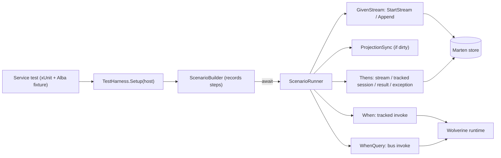

# Design: CritterStack.TestHarness

The cohesive design for the harness, unifying the [PDRs](../product-decision-log/README.md) (what it does for a test author) and the [ADRs](../architecture-decision-log/README.md) (how it is built). It describes what the harness is and how its parts fit together; the order of work is the [implementation plan](../implementation-plan/00-overview.md).

## Purpose

Services built on Marten and Wolverine get a fluent Given/When/Then scenario API that runs on their own Alba test host: Givens write event streams, `When` sends a command through Wolverine under tracking, `WhenQuery` sends a query, and Thens assert on appended events, whole streams, published messages, query results and handler exceptions. Async projections are brought up to date before each action, and failures show the actual data.

## Design documents

| Document | Covers | Grounded in |
|---|---|---|
| [01-harness-design.md](./01-harness-design.md) | Target API, execution, projection sync, exception classification, stage interfaces, files, tests, verification findings, documentation rules | PDR-0001 to 0009, ADR-0002 to 0012 |

User-facing explanations of the same design (for people *using* the harness) are in [`../explanation/`](../explanation/execution-model.md).

## Where each record lands

| Record | Design section | Code |
|---|---|---|
| [PDR-0001](../product-decision-log/PDR-0001-fluent-scenarios-on-the-services-own-host.md) Fluent scenarios on the service's host | Target API, Design: Setup | `TestHarness.cs`, `Stages/` |
| [PDR-0002](../product-decision-log/PDR-0002-appended-vs-whole-stream-assertions.md), [ADR-0006](../architecture-decision-log/ADR-0006-appended-events-by-version-snapshot.md) Appended vs whole stream | Design: Thens, How "appended" is measured | `Steps/StreamAssertionStep.cs`, `ScenarioRunner.cs` |
| [PDR-0003](../product-decision-log/PDR-0003-projections-current-before-every-action.md), [ADR-0007](../architecture-decision-log/ADR-0007-projection-sync-before-actions.md), [ADR-0016](../architecture-decision-log/ADR-0016-shard-watcher-catches-missed-apply-errors.md) Projection sync | Design: Setup options, Projection sync | `ProjectionSyncRunner.cs`, `ShardFailureWatcher.cs` |
| [PDR-0004](../product-decision-log/PDR-0004-handler-exceptions-are-assertable.md), [ADR-0008](../architecture-decision-log/ADR-0008-exception-classification-by-origin.md) Exceptions | Design: Captured exceptions | `ExceptionClassifier.cs`, `Steps/ThrowsAssertionStep.cs` |
| [PDR-0005](../product-decision-log/PDR-0005-failures-show-the-actual-data.md), [ADR-0010](../architecture-decision-log/ADR-0010-payloads-use-the-stores-serializer.md) Failure data | Design: Failures | `Failure.cs`, `PayloadFormatter.cs` |
| [PDR-0010](../product-decision-log/PDR-0010-adopt-as-a-nuget-package.md), [ADR-0013](../architecture-decision-log/ADR-0013-ship-the-harness-as-a-nuget-package.md) NuGet package (supersede PDR-0006, ADR-0004) | Design: Dependency rule; Files: harness library, CI | `CritterStack.TestHarness.csproj`, `scripts/check-package.sh`, `build.yml` release job |
| [PDR-0007](../product-decision-log/PDR-0007-one-tenant-per-scenario.md), [ADR-0009](../architecture-decision-log/ADR-0009-commands-tracked-queries-through-the-bus.md) Tenancy, invoke paths | Design: Multi-tenancy, When, Queries | `Steps/WhenCommandStep.cs`, `Steps/WhenQueryStep.cs` |
| [PDR-0008](../product-decision-log/PDR-0008-v1-non-goals.md) Non-goals | Design: v1 scope, No data wipe | (absence) |
| [PDR-0009](../product-decision-log/PDR-0009-diataxis-docs-with-runnable-samples.md), [ADR-0012](../architecture-decision-log/ADR-0012-docs-and-portability-enforced-by-tests.md) Docs and portability checks | Documentation; Risks | `DocSamples/`, `scripts/check-package.sh` |
| [ADR-0005](../architecture-decision-log/ADR-0005-deferred-steps-and-staged-interfaces.md) Deferred steps, staged interfaces | Fluent stage interfaces | `ScenarioBuilder.cs`, `QueryStage.cs`, `Stages/` |
| [ADR-0002](../architecture-decision-log/ADR-0002-pinned-critter-stack-versions.md), [ADR-0011](../architecture-decision-log/ADR-0011-build-quality-versioning-and-ci.md) Stack, build, CI | Files: scaffolding | `global.json`, `src/Directory.*`, `.github/workflows/build.yml` |
| [ADR-0018](../architecture-decision-log/ADR-0018-critter-stack-floor-and-latest.md) Floor and latest versions | Files: scaffolding | `src/Directory.Packages.props`, `scripts/latest-versions.sh`, `.github/workflows/compatibility.yml` |
| [ADR-0003](../architecture-decision-log/ADR-0003-real-postgres-test-hosts.md) Test hosts | Tests | `CritterStack.TestHarness.Tests/Infrastructure/` |
| [PDR-0011](../product-decision-log/PDR-0011-scenarios-can-test-http-endpoints.md), [ADR-0014](../architecture-decision-log/ADR-0014-whenhttp-through-alba-under-tracking.md) HTTP endpoints | Design: HTTP requests | `Stages/IHttpStage.cs`, `Internal/HttpStage.cs`, `Steps/WhenHttpStep.cs`, `Steps/StatusCodeAssertionStep.cs`, `Steps/ResponseAssertionStep.cs` |
