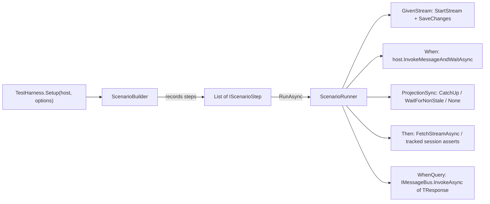
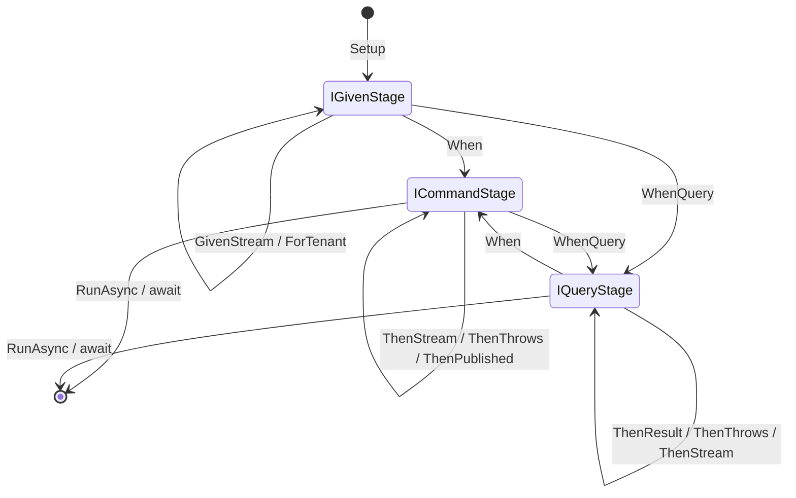

# Fluent Marten/Wolverine Test Harness

## Target API

```csharp
[Collection("Harness")]
public class WidgetScenarios(HarnessHostFixture fixture)
{
    [Fact]
    public async Task Renaming_widget_appends_WidgetRenamed()
    {
        var id1 = Guid.NewGuid();

        await TestHarness
            .Setup(fixture.Host, o => o.ProjectionTimeout = TimeSpan.FromSeconds(30))
            .GivenStream<Widget>(id1, id => [new WidgetCreated(id, "Sprocket")])
            .When(() => new RenameWidget(id1, "Gear"))
            .ThenStreamHasEvent<WidgetRenamed>(id1, e => e.Name == "Gear")
            .WhenQuery<WidgetSummary>(() => new GetWidgetById(id1))
            .ThenResult(r => r.Name == "Gear")
            .RunAsync(); // scenario is also awaitable directly
    }

    [Fact]
    public async Task Query_only_scenario()
    {
        var id1 = Guid.NewGuid();

        await TestHarness
            .Setup(fixture.Host)
            .GivenStream<Widget>(id1, id => [new WidgetCreated(id, "Sprocket")])
            .WhenQuery<WidgetSummary>(() => new GetWidgetById(id1))
            .ThenResult(r => r.Id == id1);
    }
}
```

## Design



- **Deferred execution:** each fluent call adds a step to a list. `RunAsync()` (or awaiting the builder through `GetAwaiter`) runs the steps in order. This lets the builder chain synchronously, as in your sketch.
- **Portability rule:** the harness depends only on the Alba, Marten and Wolverine abstractions. It has no knowledge of any service's aggregates, projections, schemas, fixtures or transports, so you can copy the project into another service and use it unchanged. Everything that varies between services is set through `HarnessOptions`.
- **Setup:** `TestHarness.Setup(IHost host, Action<HarnessOptions>? configure)`. `IAlbaHost` is an `IHost`, so any service's existing Alba fixture works. The harness never builds or owns a host; the caller's fixture owns the host, containers and lifetime. Options:
  - `ProjectionSync`, one of:
    - `CatchUp` (default): calls `ForceAllMartenDaemonActivityToCatchUpAsync`, which works whether or not the host runs an async daemon.
    - `WaitForNonStale`: calls `WaitForNonStaleProjectionDataAsync`, for hosts that already run the daemon.
    - `None`: for services with only inline projections.
  - `ProjectionTimeout`
  - `DocumentStore`: a `Func<IServiceProvider, IDocumentStore>` that defaults to the main `IDocumentStore`. Use it for services that use an ancillary store (`IDocumentStore` subtypes).
  - `TrackingTimeout`
  - `IncludeExternalMessages` (Wolverine tracking)
- **Stream identity:** overloads for both `Guid` and `string` stream ids, which covers Marten's two `StreamIdentity` modes. Both have plain and `<TAggregate>` forms.
- **Multi-tenancy:** an optional `ForTenant(tenantId)` on the builder. It opens sessions with `LightweightSession(tenantId)` and invokes Wolverine with that tenant id. If it isn't used, sessions use the default tenant.
- **Givens:**
  - `GivenStream(Guid id, Func<Guid, object[]> events)` and `GivenStream<TAggregate>(...)` call `session.Events.StartStream`.
  - Each Given is a separate `SaveChangesAsync`.
  - After the Givens, the harness runs the configured projection sync step (see **Projection sync** below). It makes no assumption about which projections exist or how the host runs them.
- **When:**
  - `When(Func<object> command)` runs `host.InvokeMessageAndWaitAsync(command)`, which is Wolverine tracking. It keeps the `ITrackedSession` and then runs the configured projection sync step.
  - If the command throws, the harness captures the exception for `ThenThrows<T>` instead of failing straight away.
- **Captured exceptions (When and WhenQuery alike):**
  - Both `When` and `WhenQuery` capture a thrown exception instead of failing straight away.
  - `ThenThrows<T>` checks the most recent captured exception. Its type has to match `T` (including subclasses), or an `AggregateException` from tracking has to wrap one, and the optional predicate has to pass.
  - If an exception isn't claimed by a `ThenThrows` before the next `When` or `WhenQuery` (or before the end of the scenario), it fails the scenario as an unexpected exception. The failure message gives the exception type and the step name.
  - `ThenResult` after a query that threw fails with "query threw `<type>`" rather than a null-reference error.
  - `ThenThrows` after a `When` or `WhenQuery` that didn't throw fails with "expected `<type>`, nothing thrown".
  - Exception messages are not copied into failure text, because they may echo user data.
- **Thens:**
  - `ThenStreamHasEvent<T>(id, predicate)`
  - `ThenStreamHasNoEvent<T>(id)`
  - `ThenStreamEventCount(id, n)`
  - `ThenThrows<TException>(predicate?)`, valid after a `When` or a `WhenQuery`.
  - `ThenPublished<TMessage>(predicate?)`, which reads from the tracked session and is valid only after a `When`.
- **Step ordering:** the stage interfaces below enforce the order at compile time.
  - `When` is optional. A scenario can go straight from the Givens to `WhenQuery`, as in `Setup → GivenStream... → WhenQuery → ThenResult`, or even from `Setup` to `WhenQuery` with no Givens.
  - Givens are allowed only before the first `When` or `WhenQuery`.
  - Stream assertions need a `When` or a `WhenQuery` before them.
  - `ThenThrows` exists after a `When` or a `WhenQuery`. `ThenPublished` exists only after a `When`, because a query invoke has no tracked session.
  - Projection sync runs after the last Given whether a `When` follows or a `WhenQuery` does.
  - Each `Then` refers to the most recent `When` or `WhenQuery` before it.
- **Queries:** `WhenQuery<TResponse>(Func<object> query)` runs `IMessageBus.InvokeAsync<TResponse>` and stores the typed response. `ThenResult(Func<TResponse, bool>)` asserts on it with no runtime cast. Queries run through Wolverine, not HTTP; the HTTP contract stays in the endpoint tests.
- **Failures:** the harness throws `ScenarioAssertionException`. The message names the failing step and lists the actual event *type names and versions* only. It never includes event or response payloads, because a consuming service's events may carry PII.
- **No data wipe:** the harness never calls `ResetAllMartenDataAsync` or `CleanAllMartenDataAsync`, because those truncate tables. Isolating tests is the caller's job, for example with a fresh id per test.

## Fluent stage interfaces

Each method returns the interface for the next stage, so IntelliSense offers only valid steps and a misordered scenario fails to compile. One internal `ScenarioBuilder<TResponse>` implements all of them and records steps; the interfaces only limit what can be called next.

```csharp
namespace CritterStack.TestHarness;

// TestHarness.Setup(host, o => ...) returns IGivenStage.

public interface IScenario
{
    Task RunAsync(CancellationToken cancellationToken = default);
    TaskAwaiter GetAwaiter();
}

public interface IGivenStage
{
    IGivenStage ForTenant(string tenantId);

    IGivenStage GivenStream(Guid id, Func<Guid, object[]> events);
    IGivenStage GivenStream(string id, Func<string, object[]> events);
    IGivenStage GivenStream<TAggregate>(Guid id, Func<Guid, object[]> events) where TAggregate : class;
    IGivenStage GivenStream<TAggregate>(string id, Func<string, object[]> events) where TAggregate : class;

    ICommandStage When(Func<object> command);
    IQueryStage<TResponse> WhenQuery<TResponse>(Func<object> query);
}

// Steps valid after any When or WhenQuery.
public interface IThenStage<out TSelf> : IScenario
    where TSelf : IThenStage<TSelf>
{
    TSelf ThenStreamHasEvent<TEvent>(Guid id, Func<TEvent, bool>? predicate = null);
    TSelf ThenStreamHasEvent<TEvent>(string id, Func<TEvent, bool>? predicate = null);
    TSelf ThenStreamHasNoEvent<TEvent>(Guid id);
    TSelf ThenStreamHasNoEvent<TEvent>(string id);
    TSelf ThenStreamEventCount(Guid id, int expected);
    TSelf ThenStreamEventCount(string id, int expected);

    TSelf ThenThrows<TException>(Func<TException, bool>? predicate = null) where TException : Exception;

    ICommandStage When(Func<object> command);
    IQueryStage<TResponse> WhenQuery<TResponse>(Func<object> query);
}

// After When(command): adds the command-only assertions (tracked-session based).
public interface ICommandStage : IThenStage<ICommandStage>
{
    ICommandStage ThenPublished<TMessage>(Func<TMessage, bool>? predicate = null);
}

// After WhenQuery<TResponse>(query): adds a typed result assertion.
public interface IQueryStage<TResponse> : IThenStage<IQueryStage<TResponse>>
{
    IQueryStage<TResponse> ThenResult(Func<TResponse, bool> predicate);
}
```



- Only `ICommandStage` and `IQueryStage` can be run or awaited. A scenario with only Givens has nothing to check, so it won't compile as a runnable scenario.
- Inside the harness, steps share one recorded list. The typed `IQueryStage<TResponse>` is a thin wrapper over that list, so switching between commands and queries keeps the full history.

## Files

This is a standalone repo. The harness library lives in `src/CritterStack.TestHarness/` (root namespace `CritterStack.TestHarness`).

Repo scaffolding:

- `src/CritterStack.TestHarness.slnx`: solution file containing the harness and its test project.
- `src/Directory.Packages.props`: central package versions for Alba, Marten 9.23, WolverineFx 6.26, WolverineFx.Marten, Testcontainers.PostgreSql and xunit.
- `src/Directory.Build.props`: shared build settings, and adds xunit and the test SDK to every `*.Tests` project.
- `justfile` (repo root): `build` and `test` recipes over the slnx.

Harness library:

- `src/CritterStack.TestHarness/CritterStack.TestHarness.csproj`: references Alba, Marten and WolverineFx with central versions. The csproj stays self-contained (no `ProjectReference`, no custom build imports), so a consuming service can copy the project and only needs those three packages in its own central versions.
- `TestHarness.cs`: static `Setup` entry point.
- `HarnessOptions.cs`
- `Stages/`: `IScenario.cs`, `IGivenStage.cs`, `IThenStage.cs`, `ICommandStage.cs` and `IQueryStage.cs`, one public interface per file.
- `ScenarioBuilder.cs` (internal): implements `IGivenStage` and `ICommandStage`, and records the steps.
- `QueryStage.cs` (internal): implements `IQueryStage<TResponse>` over the same builder.
- `Steps/`: `GivenStreamStep`, `WhenCommandStep`, `WhenQueryStep`, `StreamAssertionStep`, `ThrowsAssertionStep`, `PublishedAssertionStep`, `ResultAssertionStep`.
- `ScenarioContext.cs`: holds the host, tracked session, last exception and last query result.
- `ScenarioAssertionException.cs`

## Tests

The harness gets its own test project, `src/CritterStack.TestHarness.Tests/`, which travels with the harness. It has its own tiny test domain and host:

- `TestDomain/`: a minimal domain that exercises every harness feature without depending on any service:
  - an aggregate, `Widget`;
  - events `WidgetCreated`, `WidgetRenamed` and `WidgetPublished`;
  - commands `RenameWidget`, `PublishWidget` (which cascades a `WidgetPublishedNotice` message) and `FailWidget` (whose handler throws `WidgetException`);
  - a query `GetWidgetById` plus its handler, which throws `WidgetNotFoundException` for an unknown id;
  - one inline read model and one async read model, `WidgetSummary`.
- `Infrastructure/HarnessHostFixture.cs`: starts a Postgres Testcontainer, then `AlbaHost.For(WebApplication.CreateBuilder())`. On that host it runs `AddMarten(...).IntegrateWithWolverine()` with the test projections, plus Wolverine with `DisableAllExternalWolverineTransports()`. It registers no daemon, so `CatchUp` is proven against a host that has none. A second fixture variant with `AddAsyncDaemon(Solo)` covers `WaitForNonStale`.
- `Infrastructure/HarnessCollection.cs`: an xUnit collection fixture.
- `TestHarnessTests.cs`, `ProjectionSyncTests.cs`, `StepOrderingTests.cs` and `AssertionMessageTests.cs`, which together cover:
  - a Given creates the stream, for both `Guid` and `string` ids;
  - steps run only on `RunAsync` or `await`;
  - a failed `ThenStreamHasEvent` throws `ScenarioAssertionException` without the payload in its message;
  - `ThenThrows` captures a handler exception;
  - `ThenPublished` sees the cascaded message;
  - in `CatchUp` mode, `WhenQuery`/`ThenResult` reads the async read model;
  - `ProjectionSync.None` leaves the async read model stale;
  - `WaitForNonStale` works against a host that runs a daemon;
  - a Given followed by `WhenQuery` and `ThenResult`, with no command, works;
  - a scenario that chains `When`, then `WhenQuery`, then `When`, then `WhenQuery` keeps the full step history, and each `Then` checks the right result;
  - `WhenQuery` for an unknown widget, then `ThenThrows<WidgetNotFoundException>()`, passes;
  - a `When` or `WhenQuery` that throws with no `ThenThrows` after it fails the scenario as an unexpected exception;
  - `ThenResult` after a query that threw fails with a clear message;
  - `ThenThrows` when nothing was thrown fails;
  - `WhenQuery<TResponse>` with the wrong response type surfaces Wolverine's error as a `ScenarioAssertionException` that names the step.
- Package needs: Alba, Marten, WolverineFx, WolverineFx.Marten and Testcontainers.PostgreSql, all pinned in `src/Directory.Packages.props`. xunit comes from `src/Directory.Build.props` for `*.Tests`.

Every test gets a `business_value` trait that states what the test protects.

## Risks / verify during implementation

- I will confirm these Marten 9.23 and Wolverine 6.26 APIs with Context7 before relying on them: `ForceAllMartenDaemonActivityToCatchUpAsync`, `InvokeMessageAndWaitAsync`, and the `ITrackedSession` shape. If catch-up is missing, the fallback is `store.BuildProjectionDaemonAsync()` then `CatchUpAsync`.
- The harness tests' own host disables external transports, so tracking stays fast and predictable there. Consuming services whose hosts run real transports (for example Service Bus or Kafka emulators) may need `IncludeExternalMessages` or a longer `TrackingTimeout` for cascaded messages.
