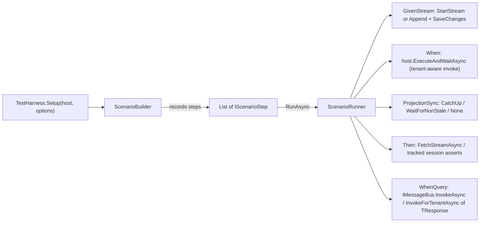
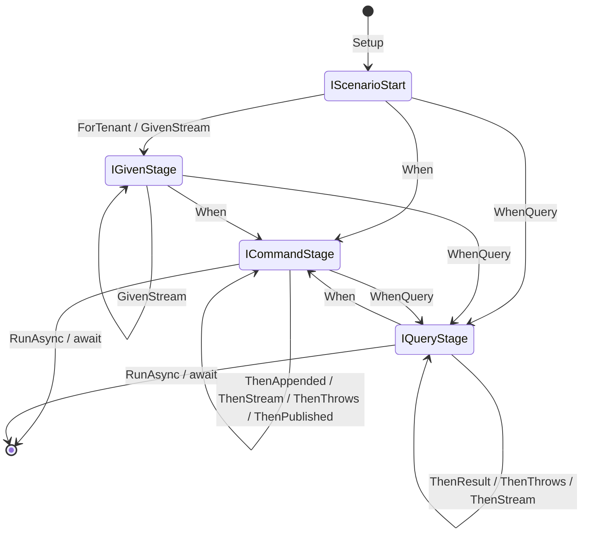

# Fluent Marten/Wolverine Test Harness

## Target API

```csharp
[Collection(nameof(NoDaemonCollection))]
public class WidgetScenarios(NoDaemonHostFixture fixture)
{
    [Fact]
    public async Task Renaming_widget_appends_WidgetRenamed()
    {
        var id1 = Guid.NewGuid();

        await TestHarness
            .Setup(fixture.Host, o => o.ProjectionTimeout = TimeSpan.FromSeconds(30))
            .GivenStream<Widget>(id1, id => [new WidgetCreated(id, "Sprocket")])
            .When(() => new RenameWidget(id1, "Gear"))
            .ThenAppended<WidgetRenamed>(id1, e => e.Name == "Gear")
            .ThenAppendedCount(id1, 1)
            .WhenQuery<WidgetSummary>(() => new GetWidgetById(id1))
            .ThenResult(r => r.Name == "Gear")
            .RunAsync(); // scenario is also awaitable directly
    }

    [Fact]
    public async Task Query_only_scenario()
    {
        var id1 = Guid.NewGuid();

        await TestHarness
            .Setup(fixture.Host)
            .GivenStream<Widget>(id1, id => [new WidgetCreated(id, "Sprocket")])
            .WhenQuery<WidgetSummary>(() => new GetWidgetById(id1))
            .ThenResult(r => r.Id == id1);
    }
}
```

## Design



- **Deferred execution:** each fluent call adds a step to a list. `RunAsync()` (or awaiting the builder through `GetAwaiter`) runs the steps in order. This lets the whole scenario read as one synchronous chain.
- **Portability rule:** the harness depends only on the Alba, Marten and Wolverine abstractions. It has no knowledge of any service's aggregates, projections, schemas, fixtures or transports, so you can copy the project into another service and use it unchanged. Everything that varies between services is set through `HarnessOptions`.
- **Setup:** `TestHarness.Setup(IHost host, Action<HarnessOptions>? configure)`. `IAlbaHost` is an `IHost`, so any service's existing Alba fixture works. The harness never builds or owns a host; the caller's fixture owns the host, containers and lifetime. Options:
  - `ProjectionSync`, one of:
    - `CatchUp` (default): calls `ForceAllMartenDaemonActivityToCatchUpAsync`, which works whether or not the host runs an async daemon.
    - `WaitForNonStale`: calls `WaitForNonStaleProjectionDataAsync`, for hosts that already run the daemon.
    - `None`: for services with only inline projections.
  - `ProjectionTimeout`
  - `TrackingTimeout`
  - `IncludeExternalMessages` (Wolverine tracking)
- **v1 scope: main store, Guid stream ids.** The harness always uses the host's main `IDocumentStore` and supports only `StreamIdentity.AsGuid`. Stream methods take a `Guid` id and come in plain and `<TAggregate>` forms. Not in v1:
  - **String stream ids** (`StreamIdentity.AsString`): would add `string` overloads of every stream method, plus a test host configured for string ids.
  - **Ancillary stores** (`IDocumentStore` subtypes): would need a generic `UseStore<TStore>()` option so projection sync can call the `<TStore>` overloads of the host sync methods.
- **Multi-tenancy:** one tenant per scenario. `Setup` returns `IScenarioStart`, which adds `ForTenant(tenantId)` on top of `IGivenStage`. `ForTenant` returns a plain `IGivenStage`, so it can only be called once, straight after `Setup` and before any Given. If it isn't called, the scenario uses Marten's default tenant. When a tenant is set, every step uses it:
  - Givens and all Then reads open sessions with `LightweightSession(tenantId)`;
  - `When` runs `host.ExecuteAndWaitAsync(c => c.InvokeForTenantAsync(tenantId, command))` under tracking;
  - `WhenQuery` runs `bus.InvokeForTenantAsync<TResponse>(tenantId, query)`.
  - Without a tenant, `When` runs `host.ExecuteAndWaitAsync(c => c.InvokeAsync(command))` and `WhenQuery` runs `bus.InvokeAsync<TResponse>(query)`. Both paths share one code path that only differs in the invoke call.
- **Givens:**
  - `GivenStream(Guid id, Func<Guid, object[]> events)` and `GivenStream<TAggregate>(...)` write events to a stream. The scenario remembers which stream ids its Givens have already started:
    - the first `GivenStream` for an id calls `session.Events.StartStream` (`StartStream<TAggregate>` for the generic form);
    - later `GivenStream` calls for the same id call `session.Events.Append`, so a stream's history can be built up over several Givens.
    - On an append, the `<TAggregate>` type argument is ignored, because the stream's aggregate type was set when it started. A mismatched `<TAggregate>` on a later Given is not an error.
    - The first Given for an id always starts a new stream. If that id already exists in the database (for example, an id reused across tests), Marten's collision error fails the scenario at once as an infrastructure failure. Tests should use a fresh id each time.
  - Each Given is a separate `SaveChangesAsync`.
- **Projection sync:** the harness runs the configured `ProjectionSync` step right *before* each `When` and each `WhenQuery`, so that both a query handler and a command handler that happens to read a projection see up-to-date data. It makes no assumption about which projections exist or how the host runs them.
  - The runner keeps a "dirty" flag that is set by every Given and every `When`. A sync before a `When` or `WhenQuery` only runs if the flag is set, and clears it. So `WhenQuery` → `WhenQuery` syncs once, and a scenario that starts with `WhenQuery` and has no Givens doesn't sync at all.
  - There is no sync after the last step or before a `Then`. Stream assertions read events directly, and `ThenPublished` reads the tracked session, so neither needs projections. To assert on a read model after a `When`, follow it with a `WhenQuery`, which syncs first.
  - A sync that exceeds `ProjectionTimeout` is an infrastructure failure (see **Captured exceptions**).
- **When:**
  - `When(Func<object> command)` runs projection sync if needed, then invokes the command under Wolverine tracking with `host.ExecuteAndWaitAsync(...)` (tenant-aware, see **Multi-tenancy**). It keeps the `ITrackedSession` for `ThenPublished`.
  - If the command throws, the harness captures the exception for `ThenThrows<T>` instead of failing straight away.
- **Captured exceptions (When and WhenQuery alike):**
  - Both `When` and `WhenQuery` capture an exception thrown by the *handler* instead of failing straight away.
  - Only handler exceptions can be claimed. Harness and infrastructure failures are test setup bugs, not behaviour under test, so they fail the scenario at once with a `ScenarioAssertionException` that names the step:
    - `WhenQuery<TResponse>` where the handler's response isn't a `TResponse`;
    - a Wolverine tracking timeout on `When` (`TrackingTimeout` exceeded);
    - no handler registered for the command or query;
    - projection sync timing out (`ProjectionTimeout` exceeded).
  - The runner tells the two apart by where the exception comes from: anything thrown out of the handler pipeline (including an `AggregateException` from tracking that wraps handler exceptions) is captured. The specific Wolverine and Marten exception types for the four infrastructure cases above are confirmed during the `verify-apis` step and listed in one internal classifier.
  - `ThenThrows<T>` checks the most recent captured exception. Its type has to match `T` (including subclasses), or an `AggregateException` from tracking has to wrap one, and the optional predicate has to pass.
  - An unclaimed exception fails the scenario at the first point where it could hide the real cause: the first `Then` after the throwing step that isn't a `ThenThrows`, or the next `When`/`WhenQuery`, or the end of the scenario, whichever comes first. That step doesn't run its own check. It reports "`<step>` threw `<type>`" with the original exception attached as `InnerException`. So when you expect an exception, put `ThenThrows` first:
    ```csharp
    .When(() => new FailWidget(id))
    .ThenThrows<WidgetException>()        // claims it
    .ThenNotAppended<WidgetRenamed>(id)   // now runs normally
    ```
  - Once claimed, the exception no longer blocks later `Then`s. `ThenResult` after a claimed query exception still fails, with "query threw `<type>`, no result" rather than a null-reference error.
  - `ThenThrows` after a `When` or `WhenQuery` that didn't throw fails with "expected `<type>`, nothing thrown".
  - Every `ScenarioAssertionException` caused by an exception (unclaimed handler exceptions and the infrastructure failures above) keeps the original as `InnerException`, so its message and stack trace show up in test output. This is deliberate: the harness only runs in tests, so being able to debug a failure matters more than hiding exception text. The harness's own message still leads with the step name and exception type so the cause is obvious at a glance.
- **Thens:**
  - **Appended-event assertions** (command stage only). These check only the events the most recent `When` appended:
    - `ThenAppended<T>(id, predicate?)`
    - `ThenNotAppended<T>(id, predicate?)`
    - `ThenAppendedCount(id, n)`
  - **Whole-stream assertions** (after any `When` or `WhenQuery`). These read the full stream with `FetchStreamAsync`, including events from Givens and from earlier `When`s:
    - `ThenStreamHasEvent<T>(id, predicate?)`
    - `ThenStreamHasNoEvent<T>(id, predicate?)`
    - `ThenStreamEventCount(id, n)`
  - `ThenThrows<TException>(predicate?)`, valid after a `When` or a `WhenQuery`.
  - `ThenPublished<TMessage>(predicate?)`, which reads from the tracked session and is valid only after a `When`.
- **How "appended" is measured:** because execution is deferred, the runner knows every stream id that an appended-event assertion uses before the `When` runs. Right before invoking the command, the `When` step reads `FetchStreamStateAsync` for each of those ids and stores the version (0 if the stream doesn't exist yet). The appended-event assertions then fetch the stream and look only at events with a version above that snapshot. Streams that no appended-event assertion mentions are never snapshotted.
- **Step ordering:** the stage interfaces below enforce the order at compile time.
  - `When` is optional. A scenario can go straight from the Givens to `WhenQuery`, as in `Setup → GivenStream... → WhenQuery → ThenResult`, or even from `Setup` to `WhenQuery` with no Givens.
  - Givens are allowed only before the first `When` or `WhenQuery`.
  - Whole-stream assertions need a `When` or a `WhenQuery` before them. Appended-event assertions need a `When`, because a query appends nothing.
  - `ThenThrows` exists after a `When` or a `WhenQuery`. `ThenPublished` exists only after a `When`, because a query invoke has no tracked session.
  - Projection sync runs before each `When` and `WhenQuery` when anything has been written since the last sync (see **Projection sync**).
  - `ThenThrows`, `ThenResult`, `ThenPublished` and the appended-event assertions refer to the most recent `When` or `WhenQuery` before them. Whole-stream assertions always see the whole stream as it is when they run.
- **Queries:** `WhenQuery<TResponse>(Func<object> query)` runs projection sync if needed, then runs `IMessageBus.InvokeAsync<TResponse>` (or `InvokeForTenantAsync`) and stores the typed response. Queries are not tracked, so anything a query handler cascades is not waited for. `ThenResult(Func<TResponse, bool>)` asserts on the response with no runtime cast. Queries run through Wolverine, not HTTP; the HTTP contract stays in the endpoint tests.
- **Failures:** the harness throws `ScenarioAssertionException`. The message names the failing step, then shows what was actually there so a failed predicate is easy to diagnose:
  - stream assertions list each relevant event (the whole stream, or only the appended events for `ThenAppended*`) with its version, type name and JSON payload;
  - `ThenResult` shows the query response as JSON;
  - `ThenPublished` lists the tracked messages with their type names and JSON payloads.
  - Payloads are serialized with the store's own Marten serializer (`IDocumentStore.Options.Serializer()`), so the JSON matches what is stored, including any custom converters. Payloads are included in full, because the harness only runs in tests.
- **No data wipe:** the harness never calls `ResetAllMartenDataAsync` or `CleanAllMartenDataAsync`, because those truncate tables. Isolating tests is the caller's job, for example with a fresh id per test.

## Fluent stage interfaces

Each method returns the interface for the next stage, so IntelliSense offers only valid steps and a misordered scenario fails to compile. The interfaces only limit what can be called next; behind them:

- One internal, non-generic `ScenarioBuilder` owns the recorded step list and implements `IScenarioStart`, `IGivenStage` and `ICommandStage`.
- Each `WhenQuery<TResponse>` call returns a new, lightweight internal `QueryStage<TResponse>` that implements `IQueryStage<TResponse>` and forwards every call to the same `ScenarioBuilder`. A builder can't be generic, because `IGivenStage` and `ICommandStage` exist before any `TResponse` is known and each `WhenQuery` in a chain can use a different `TResponse`.

```csharp
namespace CritterStack.TestHarness;

// TestHarness.Setup(host, o => ...) returns IScenarioStart.

public interface IScenario
{
    Task RunAsync(CancellationToken cancellationToken = default);
    TaskAwaiter GetAwaiter();
}

// Only available straight after Setup, so the tenant is set once for the whole scenario.
public interface IScenarioStart : IGivenStage
{
    IGivenStage ForTenant(string tenantId);
}

public interface IGivenStage
{
    IGivenStage GivenStream(Guid id, Func<Guid, object[]> events);
    IGivenStage GivenStream<TAggregate>(Guid id, Func<Guid, object[]> events) where TAggregate : class;

    ICommandStage When(Func<object> command);
    IQueryStage<TResponse> WhenQuery<TResponse>(Func<object> query);
}

// Steps valid after any When or WhenQuery. Stream assertions here are whole-stream.
public interface IThenStage<out TSelf> : IScenario
    where TSelf : IThenStage<TSelf>
{
    TSelf ThenStreamHasEvent<TEvent>(Guid id, Func<TEvent, bool>? predicate = null);
    TSelf ThenStreamHasNoEvent<TEvent>(Guid id, Func<TEvent, bool>? predicate = null);
    TSelf ThenStreamEventCount(Guid id, int expected);

    TSelf ThenThrows<TException>(Func<TException, bool>? predicate = null) where TException : Exception;

    ICommandStage When(Func<object> command);
    IQueryStage<TResponse> WhenQuery<TResponse>(Func<object> query);
}

// After When(command): adds the command-only assertions (appended events and tracked session).
public interface ICommandStage : IThenStage<ICommandStage>
{
    ICommandStage ThenAppended<TEvent>(Guid id, Func<TEvent, bool>? predicate = null);
    ICommandStage ThenNotAppended<TEvent>(Guid id, Func<TEvent, bool>? predicate = null);
    ICommandStage ThenAppendedCount(Guid id, int expected);

    ICommandStage ThenPublished<TMessage>(Func<TMessage, bool>? predicate = null);
}

// After WhenQuery<TResponse>(query): adds a typed result assertion.
public interface IQueryStage<TResponse> : IThenStage<IQueryStage<TResponse>>
{
    IQueryStage<TResponse> ThenResult(Func<TResponse, bool> predicate);
}
```



- Only `ICommandStage` and `IQueryStage` can be run or awaited. A scenario with only Givens has nothing to check, so it won't compile as a runnable scenario.
- Because every `QueryStage<TResponse>` forwards to the one `ScenarioBuilder`, switching between commands and queries keeps the full history in a single step list.

## Files

This is a standalone repo. The harness library lives in `src/CritterStack.TestHarness/` (root namespace `CritterStack.TestHarness`).

Repo scaffolding:

- `src/CritterStack.TestHarness.slnx`: solution file containing the harness and its test project.
- `global.json` (repo root): pins the .NET 10 SDK (`10.0.302`, `rollForward: latestFeature`).
- `nuget.config` (repo root): copied from awen. It clears the default sources, then adds nuget.org and the festina-lente-io GitHub Packages feed, and maps `FestinaLente.*` to the GitHub feed and everything else to nuget.org:

  ```xml
  <packageSources>
    <clear />
    <add key="nuget.org" value="https://api.nuget.org/v3/index.json" protocolVersion="3" />
    <add key="github" value="https://nuget.pkg.github.com/festina-lente-io/index.json" />
  </packageSources>
  <packageSourceMapping>
    <packageSource key="nuget.org"><package pattern="*" /></packageSource>
    <packageSource key="github"><package pattern="FestinaLente.*" /></packageSource>
  </packageSourceMapping>
  ```

  GitHub Packages needs authentication even for reads. Locally, restore needs a GitHub token with `read:packages` stored for the `github` source (`dotnet nuget update source github --username <user> --password <token> --store-password-in-clear-text`); CI uses `GITHUB_TOKEN`.
- `src/Directory.Packages.props`: central package versions, pinned to the latest stable releases (as of 2026-10-01):

  | Package | Version |
  |---|---|
  | Marten | 9.44.0 |
  | WolverineFx | 6.44.0 |
  | WolverineFx.Marten | 6.44.0 |
  | Alba | 8.5.3 |
  | Testcontainers.PostgreSql | 4.15.0 |
  | xunit.v3 (needed for assembly fixtures) | 4.0.1 |
  | xunit.runner.visualstudio | 4.0.0 |
  | Microsoft.NET.Test.Sdk | 18.10.1 |
  | GitVersion.MsBuild | 6.8.2 |
  | FestinaLente.CodeStandards | 1.1.10 |

  All of them ship `net10.0` builds. `WolverineFx.Marten` 6.44.0 requires Marten ≥ 9.41.0, which 9.44.0 satisfies.
- `src/Directory.Build.props`: `TargetFramework` `net10.0`, `Nullable` enabled, `ImplicitUsings` enabled, `TreatWarningsAsErrors` on, `IncludeSourceRevisionInInformationalVersion` false, `GitVersion.MsBuild` and `FestinaLente.CodeStandards` (both `PrivateAssets="all"`) on every project, `stylecop.json` added as an `AdditionalFiles` item, and xunit v3 and the test SDK added to every `*.Tests` project. `GenerateDocumentationFile` is on for non-test projects, so with warnings as errors a missing XML doc comment on any public member (CS1591) fails the build.
- `src/Directory.Build.targets`: copied from awen. It removes the `stylecop.json` that ships inside the CodeStandards package so only the repo's copy is used. This has to be a `.targets` file, because NuGet package props are imported after `Directory.Build.props`.
- `src/stylecop.json`: copied from awen (company name, copyright header, documentation and ordering rules), so analyzer settings match across repos.
- `GitVersion.yml` (repo root): copied from `ryandanthony/awen` so versioning works the same way across repos:
  - `mode: ContinuousDelivery`, `tag-prefix: v`, strategies `Mainline` and `TaggedCommit`;
  - assembly version `MajorMinor`, file version `MajorMinorPatch`, informational version `{SemVer}+{ShortSha}`;
  - Conventional Commit bump messages: `type!:` is major, `feat:` is minor, `fix:` is patch, and `docs`/`style`/`chore`/`ci`/`build`/`test`/`refactor` don't bump;
  - branches: `main` (ContinuousDeployment, no label, patch increment), `feature/`/`feat/` (label `{BranchName}`), `NNN-` spec branches (label `alpha`) and `pull/`/`pr/` (label `pr`).
  - `GitVersion.MsBuild` stamps the version into every assembly at build time and writes `obj/gitversion.json`, so there is no hand-maintained version anywhere in the repo.
- `justfile` (repo root): `restore`, `build` (Release, over the slnx) and `test` (depends on `build`; runs `dotnet test --no-build` in Release with a `trx` logger) recipes.
- `.github/workflows/build.yml`: CI, modelled on awen's `build.yml`. Runs on pull requests to `main`, pushes to `main` and `workflow_dispatch`, on `ubuntu-latest` (which has Docker, so Testcontainers works without setup). Steps:
  1. `actions/checkout@v4` with `fetch-depth: 0` (GitVersion needs the full history and tags);
  2. `actions/setup-dotnet@v4` (SDK from `global.json`);
  3. `actions/cache@v4` for `~/.nuget/packages`, keyed on the csproj and props files;
  4. configure the `github` NuGet source with `GITHUB_TOKEN` (`dotnet nuget update source github --username github --password ${{ secrets.GITHUB_TOKEN }} --store-password-in-clear-text`), with the workflow granted `packages: read`;
  5. install `just` (`extractions/setup-just`);
  6. `just build`;
  7. extract the version from `src/CritterStack.TestHarness/obj/gitversion.json` (`SemVer` and `MajorMinorPatch`) into step outputs and the job summary;
  8. `just test`;
  9. upload the `*.trx` files as a workflow artifact (`actions/upload-artifact@v4`, `if: always()`), so failed runs keep their results.
  - No packing, tagging or publishing in v1. The extracted version is ready for a later release job (awen's `softprops/action-gh-release` and NuGet push steps are the model).

Harness library:

- `src/CritterStack.TestHarness/CritterStack.TestHarness.csproj`: references Alba, Marten and WolverineFx with central versions. The csproj stays self-contained (no `ProjectReference`, no custom build imports), so a consuming service can copy the project and only needs those three packages in its own central versions. CodeStandards and GitVersion come from `Directory.Build.props`, not the csproj, so a consuming service doesn't inherit them (or the GitHub feed) when it copies the project.
- `TestHarness.cs`: static `Setup` entry point.
- `HarnessOptions.cs`
- `Stages/`: `IScenario.cs`, `IScenarioStart.cs`, `IGivenStage.cs`, `IThenStage.cs`, `ICommandStage.cs` and `IQueryStage.cs`, one public interface per file.
- `ScenarioBuilder.cs` (internal): implements `IScenarioStart`, `IGivenStage` and `ICommandStage`, records the steps and holds the scenario's tenant id.
- `QueryStage.cs` (internal): `QueryStage<TResponse>`, created per `WhenQuery` call. It implements `IQueryStage<TResponse>` and forwards to the owning `ScenarioBuilder`.
- `Steps/`: `GivenStreamStep`, `WhenCommandStep`, `WhenQueryStep`, `StreamAssertionStep`, `AppendedAssertionStep`, `ThrowsAssertionStep`, `PublishedAssertionStep`, `ResultAssertionStep`.
- `ScenarioContext.cs`: holds the host, tracked session, last exception, last query result and the stream-version snapshots taken before the most recent `When`.
- `ScenarioAssertionException.cs`

## Tests

The harness gets its own test project, `src/CritterStack.TestHarness.Tests/`, which travels with the harness. It has its own tiny test domain and host:

- `TestDomain/`: a minimal domain that exercises every harness feature without depending on any service:
  - an aggregate, `Widget`;
  - events `WidgetCreated`, `WidgetRenamed` and `WidgetPublished`;
  - commands `RenameWidget`, `PublishWidget` (which cascades a `WidgetPublishedNotice` message), `FailWidget` (whose handler throws `WidgetException`), `StallWidget` (whose handler waits longer than a short test `TrackingTimeout`, to prove timeouts can't be claimed) and `ArchiveWidget` (whose handler loads the async `WidgetSummary` read model and throws if it is missing, to prove the sync before a `When`);
  - a query `GetWidgetById` plus its handler, which returns the async `WidgetSummary` read model and throws `WidgetNotFoundException` for an unknown id;
  - two read models: `WidgetDetails` (inline projection, always current after `SaveChanges`) and `WidgetSummary` (async projection, only current after projection sync). The `CatchUp`, `WaitForNonStale` and `None` tests all use `WidgetSummary`.
- `Infrastructure/PostgresContainerFixture.cs`: an xUnit v3 assembly fixture (`[assembly: AssemblyFixture(typeof(PostgresContainerFixture))]`) that starts one Postgres Testcontainer for the whole test assembly and exposes its connection string.
- `Infrastructure/HarnessHostFixture.cs`: an abstract base that takes the container fixture and builds `AlbaHost.For(WebApplication.CreateBuilder())`. On that host it runs `AddMarten(...).IntegrateWithWolverine()` with the test projections, plus Wolverine with `DisableAllExternalWolverineTransports()`. The event store uses conjoined tenancy (`Events.TenancyStyle = TenancyStyle.Conjoined`) and Wolverine's Marten integration routes invokes by tenant id, so `ForTenant` can be tested; scenarios without `ForTenant` run on the default tenant. Each subclass sets its own schema (`DatabaseSchemaName`, `Events.DatabaseSchemaName` and Wolverine's message storage schema through `IntegrateWithWolverine(x => x.MessageStorageSchemaName = ...)`), so the two hosts never see each other's events, read models or envelopes:
  - `NoDaemonHostFixture`: schema `harness_nodaemon`, no daemon registered, so `CatchUp` is proven against a host that has none and `None` reliably leaves the async read model stale.
  - `DaemonHostFixture`: schema `harness_daemon`, `AddAsyncDaemon(DaemonMode.Solo)`, for `WaitForNonStale`.
- `Infrastructure/Collections.cs`: two xUnit collection definitions, `NoDaemonCollection` (uses `NoDaemonHostFixture`) and `DaemonCollection` (uses `DaemonHostFixture`). The collections run in parallel with each other; tests inside one collection run one after another.
- `DocSamples/`: one test class per tutorial or how-to page, holding that page's code blocks so they compile and pass (see **Documentation**).
- `TestHarnessTests.cs`, `ProjectionSyncTests.cs`, `StepOrderingTests.cs` and `AssertionMessageTests.cs`, which together cover:
  - a Given creates the stream, in both its plain and `<TAggregate>` forms;
  - two `GivenStream` calls with the same id build one stream (start, then append), and `ThenStreamEventCount` sees all of their events;
  - `ForTenant("a")` Givens, `When` and `ThenAppended` all run as tenant `a`, and the command handler's session sees tenant `a`;
  - a stream given under tenant `a` is not visible to a scenario that uses `ForTenant("b")` (`ThenStreamEventCount(id, 0)`);
  - `WhenQuery` under `ForTenant` returns that tenant's read model;
  - steps run only on `RunAsync` or `await`;
  - a failed `ThenStreamHasEvent` throws `ScenarioAssertionException` whose message includes each actual event's version, type name and JSON payload;
  - a failed `ThenResult` includes the response as JSON in its message;
  - `ThenAppended<WidgetCreated>` fails after a `When` when `WidgetCreated` came only from the Given, while `ThenStreamHasEvent<WidgetCreated>` passes;
  - after two `When`s, `ThenAppended` and `ThenAppendedCount` see only the second command's events;
  - `ThenAppended` works on a stream that the `When` itself creates (snapshot version 0);
  - `ThenThrows` captures a handler exception;
  - a tracking timeout fails the scenario at once as a `ScenarioAssertionException` naming the `When` step, and `ThenThrows<TimeoutException>()` cannot claim it;
  - a `When` with no registered handler fails at once and cannot be claimed;
  - `ThenPublished` sees the cascaded message;
  - in `CatchUp` mode, `WhenQuery`/`ThenResult` reads the async read model;
  - `When` → `WhenQuery` sees the read model updated by the command's events (sync before the query);
  - a `When` whose handler reads the async read model sees data from the Givens (sync before the command);
  - `WhenQuery` → `WhenQuery` with nothing written in between syncs only once (verified by counting sync calls through an internal hook);
  - `ProjectionSync.None` leaves the async read model stale;
  - `WaitForNonStale` works against a host that runs a daemon;
  - a Given followed by `WhenQuery` and `ThenResult`, with no command, works;
  - a scenario that chains `When`, then `WhenQuery`, then `When`, then `WhenQuery` keeps the full step history, and each `Then` checks the right result;
  - `WhenQuery` for an unknown widget, then `ThenThrows<WidgetNotFoundException>()`, passes;
  - a `When` or `WhenQuery` that throws with no `ThenThrows` after it fails the scenario as an unexpected exception;
  - a `When` that throws, followed by `ThenAppended` and then `ThenThrows`, fails at `ThenAppended` with "`When` threw `<type>`" (not "no event appended"), and the handler exception is the `InnerException`;
  - `ThenThrows` followed by `ThenNotAppended` passes when the handler threw and appended nothing;
  - `ThenStreamHasNoEvent<WidgetRenamed>(id, e => e.Name == "Gear")` passes when the stream only has a rename to another name, and fails when it has a rename to `"Gear"`; the same for `ThenNotAppended`;
  - `ThenResult` after a query that threw fails with a clear message;
  - `ThenThrows` when nothing was thrown fails;
  - `WhenQuery<TResponse>` with the wrong response type surfaces as a `ScenarioAssertionException` that names the step and keeps Wolverine's exception as `InnerException`;
  - an unclaimed handler exception's `ScenarioAssertionException` has the original handler exception as `InnerException`.
- Package needs: Alba, Marten, WolverineFx, WolverineFx.Marten and Testcontainers.PostgreSql, all pinned in `src/Directory.Packages.props`. xunit v3 comes from `src/Directory.Build.props` for `*.Tests`.

Every test gets a `business_value` trait that states what the test protects.

## Risks / verify during implementation

- I will confirm these Marten 9.44 and Wolverine 6.44 APIs with Context7 before relying on them: `ForceAllMartenDaemonActivityToCatchUpAsync`, `ExecuteAndWaitAsync`, `InvokeForTenantAsync` (on both `IMessageContext` and `IMessageBus`), conjoined event tenancy, and the `ITrackedSession` shape. If catch-up is missing, the fallback is `store.BuildProjectionDaemonAsync()` then `CatchUpAsync`.
- The harness tests' own host disables external transports, so tracking stays fast and predictable there. Consuming services whose hosts run real transports (for example Service Bus or Kafka emulators) may need `IncludeExternalMessages` or a longer `TrackingTimeout` for cascaded messages.
- `FestinaLente.CodeStandards` brings in analyzers (StyleCop and others) that, with warnings as errors, may flag code the design takes for granted, such as one public interface per file, file headers and member ordering. The first build after `scaffold` shows how strict it is. Fix the code to comply, and only suppress a rule in `.editorconfig` with a one-line reason.
- Restore fails without a GitHub token for the `github` source, both locally and in CI.

## Documentation

User docs follow [Diátaxis](https://diataxis.fr/). It separates four kinds of documentation by what the reader needs, and keeps each page to one kind:

| Kind | Reader is... | Informs | Serves | Here, it answers |
|---|---|---|---|---|
| Tutorial | learning | action | study | "Show me, step by step, a scenario that works." |
| How-to guide | working | action | work | "How do I test X with the harness?" |
| Reference | working | cognition | work | "What exactly does this method / option / failure do?" |
| Explanation | studying | cognition | study | "Why does the harness behave this way?" |

Docs live in `docs/` as plain Markdown that renders on GitHub (no site generator in v1). The target shape is below. Following Diátaxis's own workflow, folders and pages are **not** created empty up front: a page is only added once it has real content, and a section folder appears when its first page does. For v1 the pages are written after the code they describe (see the `docs-*` todos); after v1, any change to the harness updates the affected pages in the same pull request.

```
README.md                          what it is, a 10-line example, links into docs/, build commands
docs/
  index.md                         the four sections and when to read each
  tutorials/
    first-scenario.md              add the harness to a small service, write a Given/When/Then, run it green, break it on purpose and read the failure
  how-to/
    add-to-a-service.md            copy the project in, add package versions, wire it to an existing Alba fixture
    choose-projection-sync.md      pick CatchUp / WaitForNonStale / None for your host
    test-expected-exceptions.md    ThenThrows first, predicates, what can't be claimed
    assert-published-messages.md   ThenPublished, hosts with real transports, IncludeExternalMessages, TrackingTimeout
    test-multi-tenant-handlers.md  ForTenant and tenant isolation
    query-read-models.md           When then WhenQuery, ThenResult
    debug-a-failing-scenario.md    reading the failure message, payloads, InnerException
  reference/
    api.md                         every stage and method, laid out to mirror the stage interfaces, with the valid-next-step table
    harness-options.md             every HarnessOptions field: type, default, effect
    failure-messages.md            every failure the harness raises: when, message shape, claimable or not
    compatibility.md               supported .NET, Marten, Wolverine and Alba versions; v1 limits (Guid ids, main store)
  explanation/
    execution-model.md             deferred steps, the runner, why the chain is synchronous
    appended-vs-whole-stream.md    the two kinds of stream assertion and the version snapshot
    projection-sync.md             why sync runs before When and WhenQuery, and the dirty flag
    exception-handling.md          handler vs infrastructure failures, why unclaimed exceptions fail early
    design-decisions.md            portability, no data wipe, one tenant per scenario, payloads in failures, what v1 leaves out
```

Writing rules, from the Diátaxis guidance for each kind:

- **Tutorial:** one guided path that is certain to succeed, with visible results early and often ("the test passes", then "now the failure shows the event JSON"). It states expected output at each step and keeps explanation to one line plus a link into `explanation/`.
- **How-to guides:** assume a reader who already knows the harness and has a goal. Title each one "How to ...", give only the steps, and link out to reference and explanation rather than repeating them.
- **Reference:** austere, complete, consistent. The layout mirrors the code (one section per stage interface, in the order the stages run), and each entry uses the same pattern: signature, stage it's valid on, stage it returns, behaviour, failure, short example. No instructions or opinions.
- **Explanation:** the "why" lives only here. It may discuss alternatives and trade-offs (most of the answers in this design review belong here).
- **Review check (the Diátaxis compass):** for each page, and for any paragraph that feels off, ask "action or cognition?" and "study or work?". If the answer doesn't match the page's section, move the content to the right page and link to it.

Keeping the docs accurate:

- **XML doc comments (reference in the IDE):** every public type and member in `CritterStack.TestHarness` has a `<summary>`, and methods have `<param>`, `<returns>` and, where useful, `<example>` and `<exception>`. Stage methods state the stage they're valid on and the stage they return, and Thens state which `When` or `WhenQuery` they refer to, so IntelliSense carries the step-ordering rules. These comments are reference material, so they follow the reference rules above. `GenerateDocumentationFile` plus warnings as errors makes a missing comment fail the build. `docs/reference/api.md` uses the same wording, so the two never disagree.
- **Samples that compile and pass:** every code block in `docs/tutorials/` and `docs/how-to/` has a matching test in `src/CritterStack.TestHarness.Tests/DocSamples/`, one class per page. Each block carries a comment naming its test, and `just test` fails if a sample breaks.
- **This design doc** (`initial-design.md`) is the build plan, not user documentation. Once v1 ships, the parts worth keeping move into `docs/explanation/design-decisions.md`.

## Todos

In build order. Each item lists what "done" means.

- [ ] **verify-apis:** Use Context7 to confirm, for the pinned Marten 9.44 and Wolverine 6.44 versions:
  - Marten: `ForceAllMartenDaemonActivityToCatchUpAsync`, `WaitForNonStaleProjectionDataAsync`, `FetchStreamAsync`, `FetchStreamStateAsync`, `StartStream`/`Append`, conjoined event tenancy, and `Options.Serializer()`;
  - Wolverine: `ExecuteAndWaitAsync`, `InvokeForTenantAsync` (on `IMessageContext` and `IMessageBus`), the `ITrackedSession` shape (for `ThenPublished`), tracking options for `TrackingTimeout` and `IncludeExternalMessages`, and `MessageStorageSchemaName` on `IntegrateWithWolverine`;
  - the exception types for each infrastructure failure (wrong `TResponse`, tracking timeout, no handler, sync timeout, stream id collision) and how a handler exception surfaces from tracking (direct or wrapped in `AggregateException`);
  - Alba 8.5.3 works with Wolverine 6.44 tracking on a `net10.0` host.
  - Update the design (pinned versions, API names, the **Risks** section) wherever something differs.
- [ ] **scaffold:** Add `global.json` (.NET 10 SDK), `nuget.config` (nuget.org plus the festina-lente-io GitHub feed, with source mapping), `src/Directory.Packages.props` (the pinned versions in **Files**), `src/Directory.Build.props` (`net10.0`, nullable, implicit usings, warnings as errors, CodeStandards, xunit v3 and the test SDK for `*.Tests`), `src/Directory.Build.targets` and `src/stylecop.json` (both from awen), `src/CritterStack.TestHarness.slnx` and a root `justfile` with `build` and `test` recipes. `FestinaLente.CodeStandards` restores from the GitHub feed, and `just build` succeeds on an empty solution.
- [ ] **project:** Create both projects and add them to the slnx:
  - `CritterStack.TestHarness` (Alba, Marten, WolverineFx only; no `ProjectReference`), with `InternalsVisibleTo("CritterStack.TestHarness.Tests")` for the sync-count hook;
  - `CritterStack.TestHarness.Tests` (references the harness, WolverineFx.Marten and Testcontainers.PostgreSql).
- [ ] **stages:** Add the public API: `TestHarness.Setup`, `HarnessOptions` (with defaults), `IScenario`, `IScenarioStart`, `IGivenStage`, `IThenStage<TSelf>`, `ICommandStage` and `IQueryStage<TResponse>`, each with full XML doc comments (see **Documentation**). The Target API sample compiles, a misordered chain doesn't, and the build has no CS1591 warnings.
- [ ] **core:** Implement the internal plumbing:
  - `ScenarioBuilder` (records steps, holds the tenant id, implements `IScenarioStart`, `IGivenStage` and `ICommandStage`) and `QueryStage<TResponse>` (forwards to the builder);
  - `IScenarioStep` and `ScenarioRunner`: runs steps in order on `RunAsync`/`GetAwaiter`, honours the `CancellationToken`, and pre-scans the steps to find which stream ids each `When` must snapshot;
  - `ScenarioContext`: host, tenant, tracked session, pending/claimed exception, last query result, stream-version snapshots, the started-stream set and the projection-sync "dirty" flag;
  - tenant-aware session and invoke helpers (one code path with and without a tenant);
  - projection sync (`CatchUp`, `WaitForNonStale`, `None`) with the dirty flag, `ProjectionTimeout`, and an internal hook that counts sync calls;
  - the exception classifier (handler exception vs infrastructure failure) and the unclaimed-exception rule (fail at the first non-`ThenThrows` `Then`, the next `When`/`WhenQuery`, or the end);
  - `ScenarioAssertionException` and a failure-message formatter that writes step name, event versions, type names and JSON payloads with the store's serializer, and attaches `InnerException` when caused by an exception.
- [ ] **steps:** Implement each step on top of `core`:
  - `GivenStreamStep` (start on first use of an id, append after);
  - `WhenCommandStep` (sync if dirty, snapshot versions, tracked invoke, capture handler exception, keep `ITrackedSession`);
  - `WhenQueryStep` (sync if dirty, invoke, capture handler exception, store typed result);
  - `StreamAssertionStep` (has / has-no with predicate / count, whole stream);
  - `AppendedAssertionStep` (appended / not-appended with predicate / count, since the snapshot);
  - `ThrowsAssertionStep`, `PublishedAssertionStep` and `ResultAssertionStep`.
- [ ] **test-domain:** Build `TestDomain/`: the `Widget` aggregate, its events, the `RenameWidget`, `PublishWidget`, `FailWidget`, `StallWidget` and `ArchiveWidget` commands and handlers, the `GetWidgetById` query and handler, and the `WidgetDetails` (inline) and `WidgetSummary` (async) projections.
- [ ] **fixtures:** Build `PostgresContainerFixture` (assembly fixture), the abstract `HarnessHostFixture` with conjoined tenancy and per-host schemas, `NoDaemonHostFixture`, `DaemonHostFixture`, and the `NoDaemonCollection` and `DaemonCollection` definitions. Each host starts and stops cleanly against the shared container.
- [ ] **tests:** Write `TestHarnessTests`, `ProjectionSyncTests`, `StepOrderingTests` and `AssertionMessageTests` covering every case in the **Tests** list, each with a `business_value` trait.
- [ ] **versioning:** Add `GitVersion.yml` (copied from awen) and the `GitVersion.MsBuild` reference in `src/Directory.Build.props`. `just build` produces assemblies whose informational version is `{SemVer}+{ShortSha}`, and `obj/gitversion.json` exists.
- [ ] **ci:** Add `.github/workflows/build.yml` as described in **Files**. A pull request run builds, prints the GitVersion `SemVer`, runs the full test suite (including the Testcontainers tests) and uploads the `trx` results.
- [ ] **docs-reference:** Write `docs/reference/` (`api.md`, `harness-options.md`, `failure-messages.md`, `compatibility.md`) from the finished code and XML comments. Every public member and every failure in the harness appears exactly once, in the layout described in **Documentation**.
- [ ] **docs-how-to:** Write the seven `docs/how-to/` guides, each with its code blocks backed by a `DocSamples/` test that passes.
- [ ] **docs-tutorial:** Write `docs/tutorials/first-scenario.md`, backed by `DocSamples/` tests, and walk through it from a clean clone to confirm every step and expected output is right.
- [ ] **docs-explanation:** Write the five `docs/explanation/` pages, moving the reasoning from this design review into them.
- [ ] **docs-entry:** Write `docs/index.md` and replace `README.md` (what it is, a 10-line example, links into `docs/`, `just build` / `just test`). Run the compass check over every page and fix anything in the wrong section.
- [ ] **verify:** Run `just build` and `just test` until both are green with no warnings (requires Docker for Testcontainers), then push and confirm the `build.yml` run is green.
